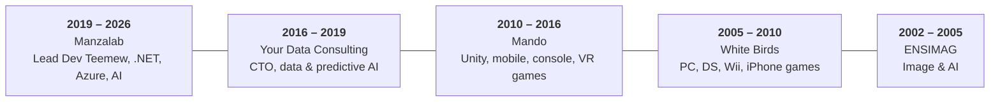

# Hi, I'm Fabien Simon 👋

**Fullstack .NET / C# & AI Tech Lead** · Paris · available immediately

20+ years of software development, including 6 years of .NET back-end in production on SaaS products. I lead development teams from architecture to production, with a close ear to functional needs.

### Recent work
- **Teemew** (Manzalab, 2019-2026): web platform for virtual events in 3D with real-time audio, up to 2,000 concurrent users. Led a fullstack team of 5.
- **AI in the product**: audio and text AI bots connected to a RAG (OpenAI API), with speech-to-text transcription.
- **Claude Code**: code review and testing agents shared with the team, contract-first multi-agent development.

### Stack
C# / .NET · ASP.NET Core · Azure · Docker · Cloudflare · Redis · MySQL · SignalR · OpenAI RAG · Unity

### Career

| Period | Role | In short | Details |
|---|---|---|---|
| 2019 – 2026 | Lead Dev | *Teemew* 3D web platform: .NET, Azure, real-time, AI | [Manzalab](https://github.com/fsimonpro/fsimonpro/blob/main/portfolio/en/manzalab.md) |
| 2016 – 2019 | CTO | *Livejourney* data visualization platform, predictive AI | [Your Data Consulting](https://github.com/fsimonpro/fsimonpro/blob/main/portfolio/en/your-data.md) |
| 2010 – 2016 | Lead Dev | Unity and mobile games, *Babel Rising 3D* on PS3, Xbox 360 and Oculus Rift | [Mando Productions](https://github.com/fsimonpro/fsimonpro/blob/main/portfolio/en/mando.md) |
| 2005 – 2010 | Junior developer, then Lead Dev | Adventure games on PC, Nintendo DS and Wii, iPhone; *Nikopol*, Best Graphics at the Milthon 2008 | [White Birds Productions](https://github.com/fsimonpro/fsimonpro/blob/main/portfolio/en/white-birds.md) |
| 2002 – 2005 | Education | ENSIMAG (Image & AI), exchange year at the University of Waterloo | [Education](https://github.com/fsimonpro/fsimonpro/blob/main/portfolio/en/formation.md) |

📂 **Detailed portfolio:** [English](https://github.com/fsimonpro/fsimonpro/blob/main/portfolio/en.md) · [Français](https://github.com/fsimonpro/fsimonpro/blob/main/portfolio/fr.md)

### Public repositories
- [**ShapeDrawingMCP**](https://github.com/fsimonpro/ShapeDrawingMCP) (C#, .NET 10): WinForms shape editor driven by mouse, by prompt (OpenAI function calling) or by an external MCP client such as Claude Code, through its own local MCP server. Animated scenes created "blind", through MCP prompts only.
- [**VoxelRendererSample**](https://github.com/fsimonpro/VoxelRendererSample) (C++/CLI, 2011): software voxel renderer in the style of *Comanche*: heightmap + albedo → 3D terrain view, no GPU, written entirely by hand.
- [**PlayableAdsSample**](https://github.com/fsimonpro/PlayableAdsSample) (Unity, C#): sliding puzzle playable ad built with the Luna (Playworks) SDK, tweakable from the Luna Playground without rebuilding.

### Contact
[LinkedIn](https://www.linkedin.com/in/fabien-simon-6783862/)
