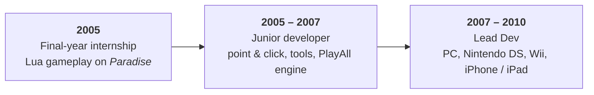
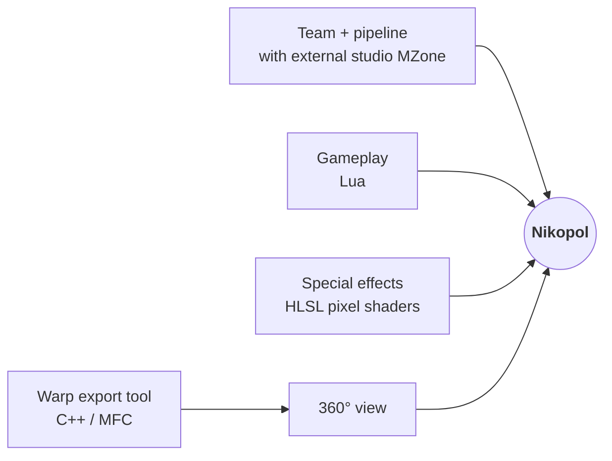
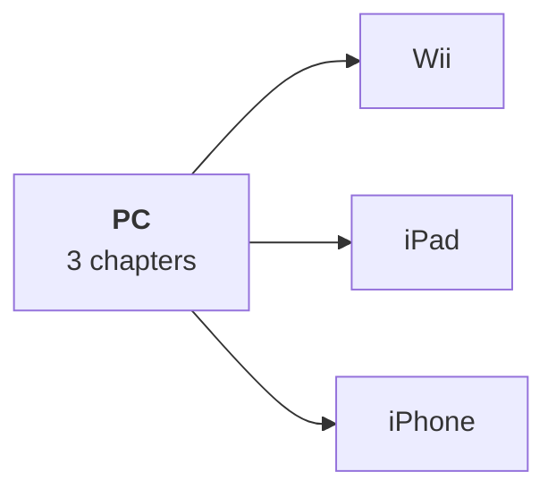

# Detailed portfolio – Fabien Simon

[Version française](fr.md) · [← Back to profile](../README.md)

Fullstack .NET / C# & AI Tech Lead, 20+ years of software development, including 11 years in the video game industry (2005–2016).

## Contents
- [White Birds Productions (2005–2010)](#white-birds-productions-20052010)
- *Coming soon: Mando Productions (2010–2016), Your Data Consulting (2016–2019), Manzalab (2019–2026), education*

---

## White Birds Productions (2005–2010)

Video game studio (mainly adventure and point & click games). I joined as a final-year intern and stayed 5 years: junior developer, then Lead Dev from 2007.

### Key figures
| | |
|---|---|
| 🏆 | ***Nikopol***: Best Graphics award at the **Milthon 2008** (French video game festival) |
| 📱 | ***Cardboard Castle***: **top 5 on the French App Store** |
| 🎮 | Games shipped on **5 platforms**: PC, Nintendo DS, Nintendo Wii, iPhone, iPad |
| 👥 | Team of up to **5 people** on *Aztec Treasure Hunt* (3 integrators, 1 engine programmer, 1 gameplay programmer) |

### Lead Dev (2007 – May 2010)

#### *Nikopol* (PC), Best Graphics at the Milthon 2008

- Export tool for the "warps" used by the 360° view (**C++ / MFC**)
- Gameplay programming in **Lua**
- Special effects in **HLSL pixel shaders**
- Set up the team and the production pipeline with an external studio (**MZone**)

#### *Kate Brooks' Adventure*, cross-platform hidden object game
- PC hidden object game in three chapters, also released on Wii, iPad and iPhone
- Set up the team and the pipeline

#### Nintendo DS
- ***Let's Play Fashion Designer***: project management through to delivery, developed in **C** with **256 KB** of memory (tight memory management)
- ***Tower Defense***: isometric display, pathfinding
- ***Nikopol DS***: 360° display on the DS
- Prototype of a 2D puzzle game in the style of *Professor Layton* (**C++**)

#### Nintendo Wii: *Aztec Treasure Hunt*
- 2D point & click with 3D tools
- Handled the **Wii TRC** (Nintendo certification requirements)
- Team of 5: 3 integrators, 1 engine programmer, 1 gameplay programmer

#### iPhone / iPad
- ***Cardboard Castle*** (**Xcode + Lua**): top 5 on the French App Store
- ***Last King of Africa***: adaptation of *Paradise*

### Junior developer (May 2005 – October 2007)

#### Final-year internship (May – September 2005): *Paradise*

- Gameplay programming in **Lua** on the in-house 2D/3D engine **Opalium** (object-oriented and event-driven programming)
- Fishing mini-game (inertia, random movements), cameras following a character
- Worked with Slovenian subcontractors through a source control system

#### Point & click games
- ***Paradise*** and ***Martine 1 & 2*** (edutainment games): in-house engine, **Lua** scripts

#### Tools and engine
- Asset export tools in **C++** and production pipelines
- Contributed to the multiplatform 3D engine ***PlayAll*** (PS3, Xbox 360, PC, C++), shared by several companies; prototype of a point & click system

### Takeaways
- **Close work with game designers**, especially on adventure games
- **Strong hardware constraints**: 256 KB of memory on the DS, Nintendo certification (Wii TRC)
- **Multiplatform production**: the same game shipped on PC, Wii, iPad and iPhone
- **First lead roles**: building teams, pipelines with external studios, project management through to delivery

### Summary by platform
| Platform | Games | Tech |
|---|---|---|
| PC | *Paradise*, *Martine 1 & 2*, *Nikopol*, *Kate Brooks' Adventure* | In-house engine, Lua, C++ / MFC, HLSL |
| Nintendo DS | *Let's Play Fashion Designer*, *Tower Defense*, *Nikopol DS*, puzzle prototype | C, C++ |
| Nintendo Wii | *Aztec Treasure Hunt*, *Kate Brooks' Adventure* | Wii TRC |
| iPhone / iPad | *Cardboard Castle*, *Last King of Africa*, *Kate Brooks' Adventure* | Xcode, Lua |
| PS3, Xbox 360, PC | *PlayAll* engine (contribution) | C++ |

---
Images: logo and box art from Wikipedia; trademarks and artwork belong to their respective owners.
