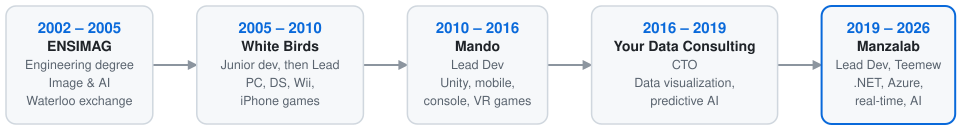

# Detailed portfolio – Fabien Simon

[Version française](fr.md) · [← Back to profile](../README.md) · [My MobyGames credits](https://www.mobygames.com/person/759004/fabien-simon/)

Fullstack .NET / C# & AI Tech Lead. 20+ years of software development, including 11 years in the video game industry, and about 19 years in lead roles.

## Periods

| Period | Role | In short | Page |
|---|---|---|---|
| 2019 – 2026 | Lead Dev | *Teemew* 3D web platform: .NET, Azure, real-time, AI | [Manzalab](en/manzalab.md) |
| 2016 – 2019 | CTO | *Livejourney* data visualization platform, predictive AI | [Your Data Consulting](en/your-data.md) |
| 2010 – 2016 | Lead Dev | Unity and mobile games, *Babel Rising 3D* on PS3, Xbox 360 and Oculus Rift | [Mando Productions](en/mando.md) |
| 2005 – 2010 | Junior developer, then Lead Dev | Adventure games on PC, Nintendo DS and Wii, iPhone; *Nikopol*, Best Graphics at the Milthon 2008 | [White Birds Productions](en/white-birds.md) |
| 2002 – 2005 | Education | ENSIMAG (Image & AI), exchange year at the University of Waterloo | [Education](en/formation.md) |
