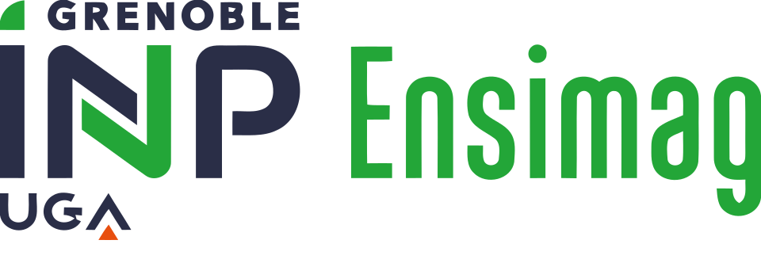
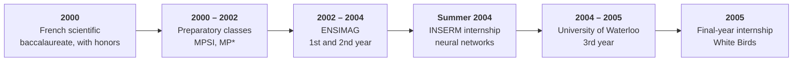
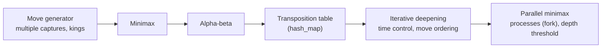
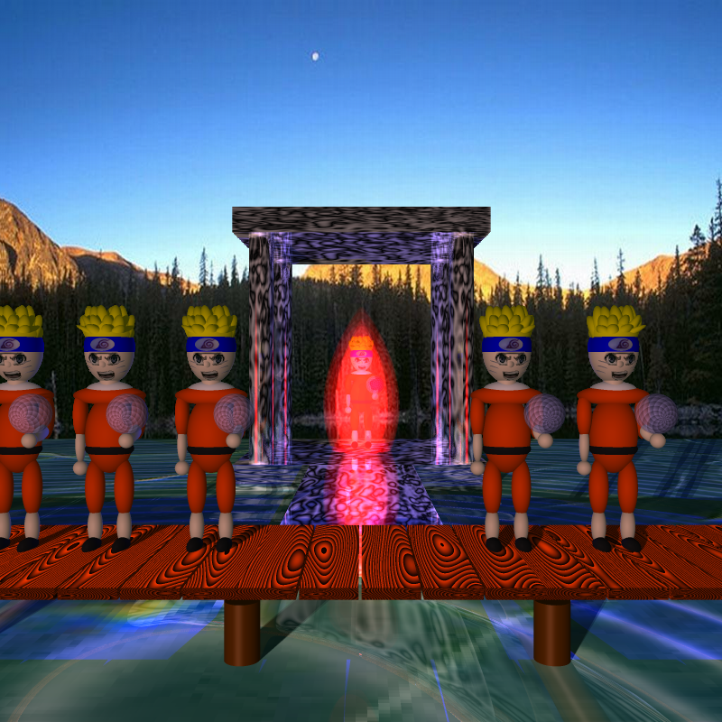
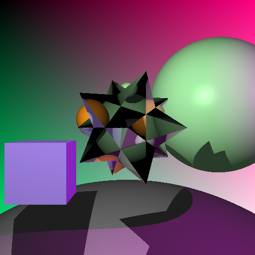
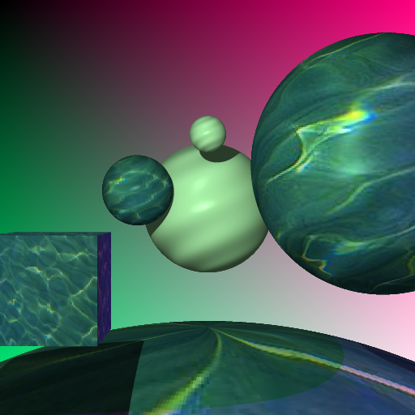
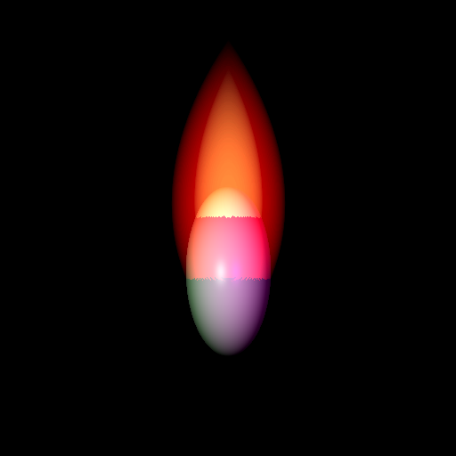
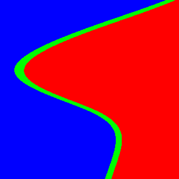

# Education (2000–2005) – Fabien Simon

[← Portfolio home](../en.md) · [Version française](../fr/formation.md)

 &nbsp; 

**Engineering degree from ENSIMAG** (Grenoble INP, France), graduated in 2005, majoring in **Image Processing and Artificial Intelligence**, with a final year on exchange at the **University of Waterloo** (Ontario, Canada).

### Highlighted projects
| Project | Year | What I did |
|---|---|---|
| **Checkers game with AI** | 2004 | C++, minimax then alpha-beta AI, transposition table, iterative deepening, parallel minimax |
| **Mini-Pascal compiler** | 2004 | Compiler to assembly, written in Ada, team of 4 (120 h) |
| **Face tracking** | 2004 | C++ control of a motorized camera that automatically follows a face |
| **Ray tracer** | 2004 | C++ (Waterloo): recursive reflections and refractions, procedural textures, bump mapping, flame simulation, animated final scene (see below) |
| **8-bit processor** | 2003 | Design of a microprogrammed processor |
| **Assembler** | 2003 | Assembler written in C for Linux |
| **Digital Eyes** | 2003–2004 | Business creation project: augmented reality for museums; appointed company head |

#### Close-up: the checkers AI

#### Close-up: the Waterloo ray tracer (CS 488, 2004)
Ray tracer written in C++ and called from Python. The final project was to render a scene inspired by the manga *Naruto*, reusing the articulated puppet (hierarchical model) from an earlier assignment.

| | |
|:---:|:---:|
|  Final scene (also rendered as an animated video) |  Recursive reflection + refraction on a mesh |
|  Bump mapping, textures and antialiasing |  Flame simulation |

- **Primitives and meshes**, hierarchical models
- **Recursive reflections** and **refractions** (adjustable indices), which can be combined
- **Textures**: from an image, procedural (wood, checkerboard, **Perlin noise**) and combinations of both
- **Bump mapping** and **antialiasing**
- **Fish-eye camera** (180° and 360°)
- **Flame simulation** (from 50 to 500 points) and **animated video** rendering
- Rendering time optimization

### ENSIMAG, 1st year (2002–2003)
- **Applied mathematics**: analysis, probability, scientific computing (Matlab), operations research and combinatorial optimization, formal language theory
- **Computer science**: algorithms and data structures, logic, networks
- **Hardware architecture**: design of a **microprogrammed 8-bit processor**; system software: **assembler in C for Linux**
- Lab work in **Ada** (grammars, language recognition) and **Java** (automata)

### ENSIMAG, 2nd year, Image track (2003–2004)
- **Courses**: compilers, databases, operating systems and concurrent programming, statistics, geometric modeling, complexity and parallelism, intelligent systems, **neural networks**, **image processing**, cryptography, business creation
- **Software engineering project**: **mini-Pascal → assembly compiler in Ada** (lexical, syntactic and semantic analysis, code generation), versioned with CVS, with design documentation, test plan and review
- **Checkers game in C++** with AI (see the diagram above)
- **Systems**: processes, pipes, **POSIX threads**, **MPI**, memory allocator in C
- **Databases**: customer account management software for phone operators in **Java + MySQL** (JDBC)
- **Geometric modeling** (Matlab): Bézier curves, B-splines, least squares, Levenberg-Marquardt
- **AI**: neural networks with **R**, expert systems in **CLIPS**
- **End-of-year project**: face tracking and camera control in C++ (skin detection with a histogram and a Gaussian model, face localization, camera servo control)
- **Digital Eyes** (4 students): augmented reality glasses for museums, companies and laser tag; business plan, market and pricing study; I was the **appointed company head**

### INSERM internship (summer 2004)
French National Institute of Health and Medical Research, unit U594 (neuroimaging), 8 weeks, as part of the European *e-tumour* project.

- **C++ toolbox for classifying brain tumors** from MRI
- Neural networks with one or more hidden layers, pyramidal, distance-based
- Backpropagation, regularization (decay), cross-validation
- Report written in English
- Opposite: a decision boundary learned by a neural network while testing the toolbox

 

### University of Waterloo, Canada (September 2004 – April 2005)
| Course | Content |
|---|---|
| **CS 488 – Computer Graphics** | OpenGL, hierarchical models (articulated puppet, trackball), C++ modules called from Python; **ray tracer project** (see the close-up above) |
| **CS 787 – Computational Vision** (graduate) | Corner detection, Gabor filters, photometric stereo, robust estimation, stereo disparity map; *shape from texture* project |
| **SYDE 372 – Pattern Recognition** | MED, MICD, MAP and nearest-neighbor classifiers, clustering |
| **SYDE 558 – Fuzzy Logic and Neural Networks** | Fuzzy logic and neural networks |
| **CS 466 – Algorithm Design and Analysis** | Algorithm design and analysis |

All courses and reports in English.

### Languages and tools learned during my studies
C, C++, Ada, Java, Python, SQL, Matlab, R, CLIPS, Unix shell, HTML, assembly; CVS, LaTeX, gdb, Unix / Linux.

### Teaching
- **ESGI**, for **3 years**: **image processing** course (Master's level, 4th year)
- **ICAN**: introduction to the **Lua** scripting language (Bachelor's level, 3rd year)
- Private tutoring in math and physics, high school final year (2003)

### Takeaways
- **AI since 2004**: neural networks during the INSERM internship, expert systems, fuzzy logic, pattern recognition
- **Images in every form**: synthesis (ray tracing, OpenGL), analysis (computer vision), and later teaching image processing
- **Low-level foundations**: processor, assembler, compiler, systems, concurrent programming
- **A year abroad**: graduate-level courses and work entirely in English

---
Next period: [White Birds Productions (2005–2010) →](white-birds.md)
