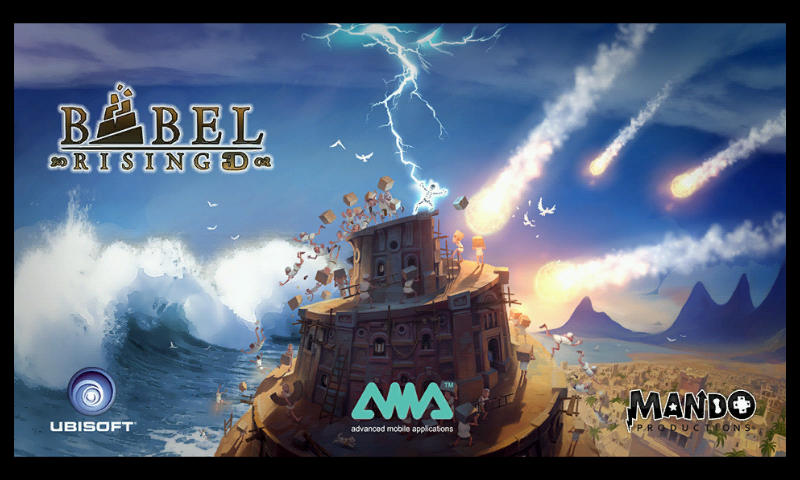
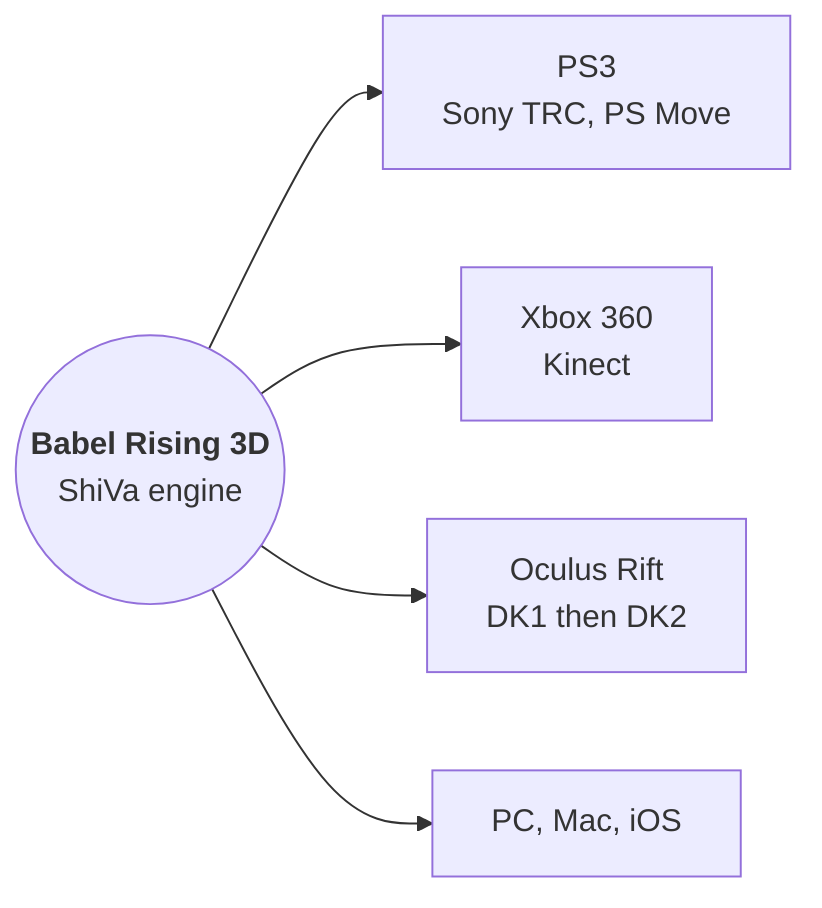
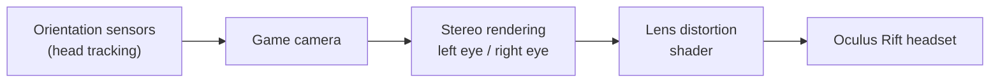
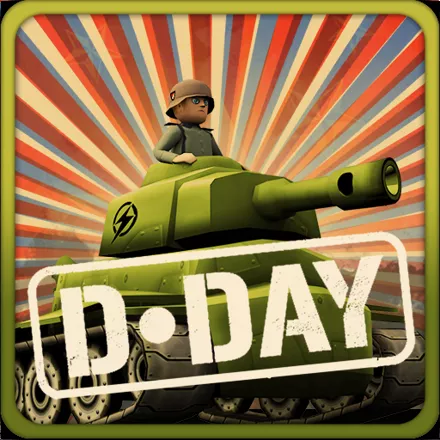
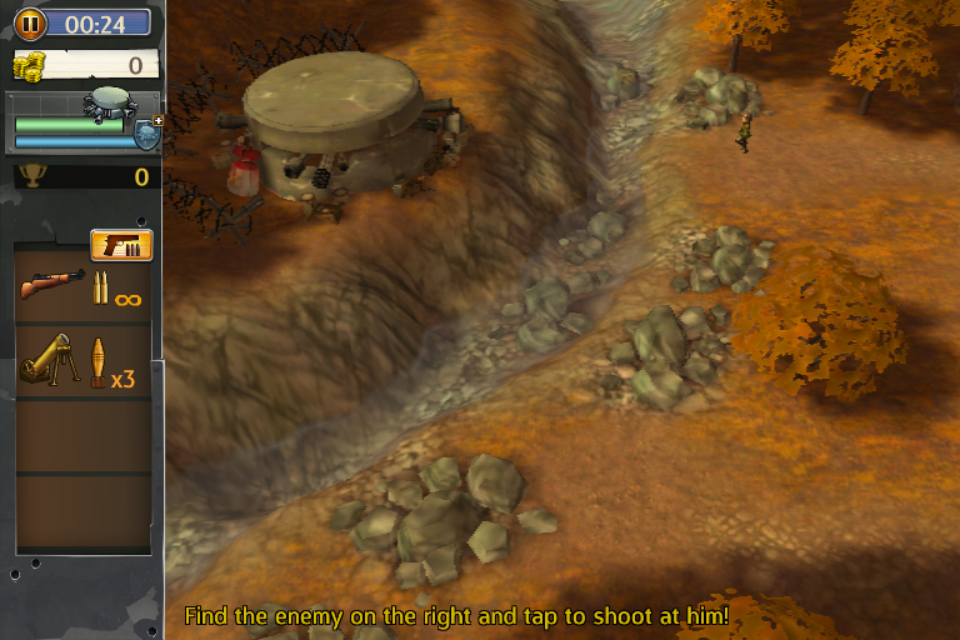

# Mando Productions (2010–2016) – Fabien Simon

[← Portfolio home](../en.md) · [Version française](../fr/mando.md) · [My MobyGames credits](https://www.mobygames.com/person/759004/fabien-simon/)

**Lead Dev, June 2010 – April 2016.** Video game studio: Unity and mobile games, consoles, virtual reality and R&D (augmented reality, mobile computer vision). I led teams of 1 to 7 people, working hand in hand with the game designers.

### Key figures
| | |
|---|---|
| 📲 | **1 to 3 million** cumulative downloads on the mobile games |
| 🥽 | ***Babel Rising 3D***: part of the **launch lineup of the first 10 games on the Oculus Rift store** |
| 🎮 | ***Babel Rising 3D*** released on **PS3** (PS Move) and **Xbox 360** (Kinect), ported to PC, Mac and iOS |
| 👥 | Teams of **1 to 7 people** |

### *Babel Rising 3D*: consoles and virtual reality

- Built with the **ShiVa** engine
- Released on **PS3** (**Sony TRC** compliance, **PS Move**) and **Xbox 360** (**Kinect**)
- Ported to **PC, Mac and iOS**
- Credited *Programming* · [MobyGames page](https://www.mobygames.com/game/57700/babel-rising-3d/)

#### Oculus Rift port (DK1 then DK2)
The game was part of the first 10 games on the Oculus store. The original SDK was very low level, so almost everything was done by hand.
- **Hand-integrated the SDK in C++** into the engine
- **Stereo rendering** and **lens distortion shader** written by hand
- **Head tracking**: reading the orientation sensors and applying them to the camera
- Worked on **latency** and **frame rate** to limit motion sickness

### Unity games (C#)

- ***Hills of Glory 3D***: iOS, Android, PC, Mac · credited *Programming* · [MobyGames page](https://www.mobygames.com/game/126860/hills-of-glory-3d/)
- ***Babel Casino***: Facebook game
- ***Runner Ocean's Run***: mobile game, social features with **Facebook SDK** integration
- Several **serious games** for companies and non-profits
- Various prototypes

### Mobile apps and SDKs
- ***Strip Messenger***: **native iOS** app (iOS SDK, **Objective-C**), real-time comic-strip style messaging; iPhone-specific features: camera, address book, keyboard interface
- **iOS in-app purchase SDK** integrated, then rolled out to **every game of the studio**
- **Facebook SDK**
- Many mobile SDKs: in-app purchases, leaderboards, social networks, ad networks (Java for some SDKs)

### R&D: augmented reality, computer vision and virtual reality
- **Banknote verification through hologram detection** on mobile (banknotes from a foreign country)
- **AR scanning of luxury rum labels** to check their authenticity
- Mobile augmented reality: **QR code** reading through the camera
- R&D on **VR headsets**: prototypes, virtual tours, 360° and 3D photos
- ***Visiwyg***: home tour solution on VR headsets and on the web (**WPF, XAML**)

### Takeaways
- **Move to Unity and C#**, which became my main technology for 15 years
- **Console constraints**: Sony certification (TRC) on PS3, Xbox 360 release
- **Early-days VR**: a low-level SDK integrated by hand, stereo rendering and fighting latency
- **Mobile at scale**: millions of downloads, monetization SDKs rolled out across the whole catalog
- **Applied R&D**: computer vision and augmented reality on mobile

### Summary by platform
| Platform | Projects | Tech |
|---|---|---|
| iOS | *Hills of Glory 3D*, *Strip Messenger*, *Babel Rising 3D* port, mobile games | Unity C#, Objective-C, in-app SDK |
| Android | *Hills of Glory 3D*, mobile games | Unity C#, Java (SDKs) |
| PC, Mac | *Hills of Glory 3D*, *Babel Rising 3D* ports | Unity C#, ShiVa |
| PS3 | *Babel Rising 3D* | ShiVa, Sony TRC, PS Move |
| Xbox 360 | *Babel Rising 3D* | ShiVa, Kinect |
| VR | *Babel Rising 3D* on Oculus Rift, *Visiwyg*, prototypes | C++, WPF / XAML |
| Facebook | *Babel Casino* | Unity C#, Facebook SDK |

[← Previous period: White Birds Productions (2005–2010)](white-birds.md) · Next period: [Your Data Consulting (2016–2019) →](your-data.md)

## References
Public credits on MobyGames:
- [Fabien Simon's MobyGames profile](https://www.mobygames.com/person/759004/fabien-simon/)
- [*Babel Rising 3D*](https://www.mobygames.com/game/57700/babel-rising-3d/) (2012): Programming
- [*Hills of Glory 3D*](https://www.mobygames.com/game/126860/hills-of-glory-3d/) (2013): Programming

---
Images from MobyGames. Trademarks and artwork belong to their respective owners.
