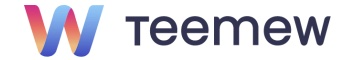
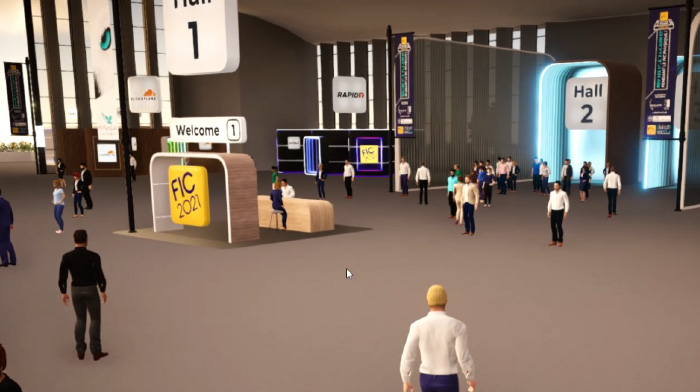
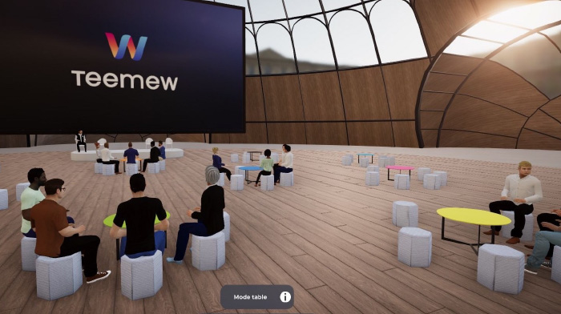
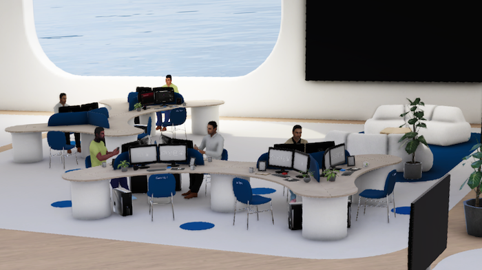
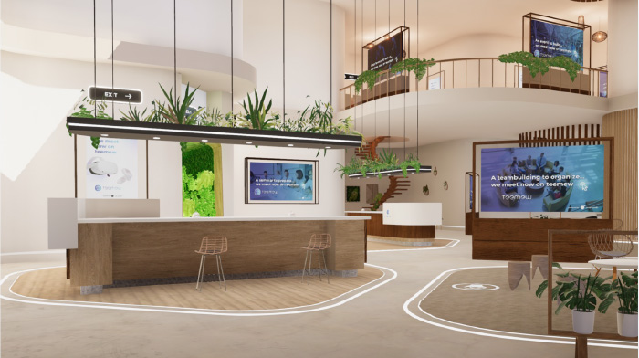
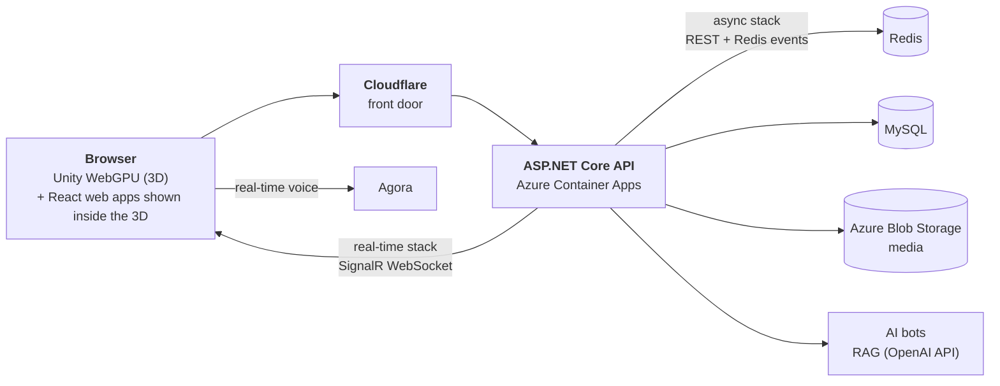
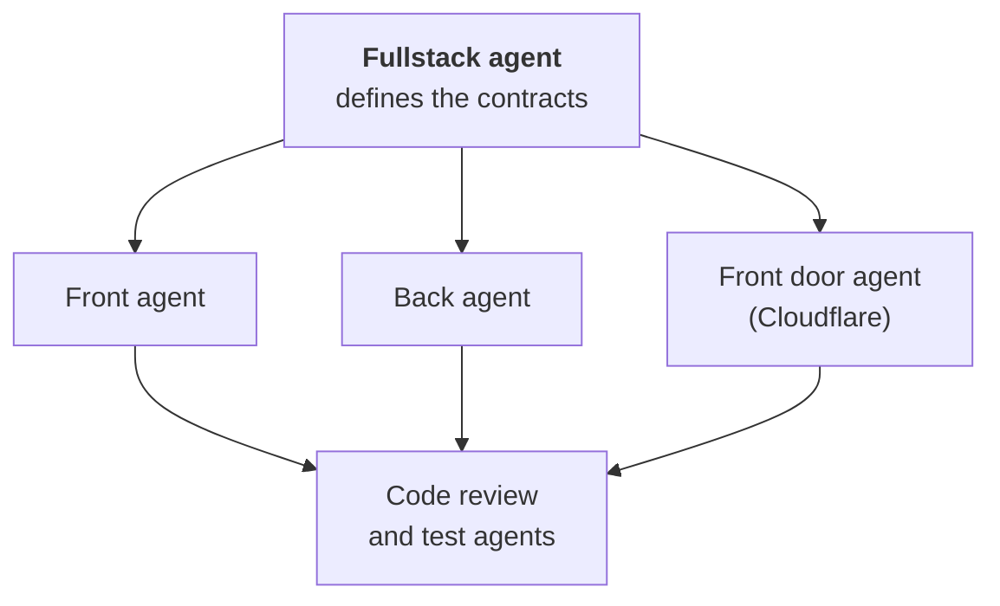

# Manzalab (2019–2026) – Fabien Simon

[← Portfolio home](../en.md) · [Version française](../fr/manzalab.md)

**Lead Dev, June 2019 – May 2026.** Led the fullstack team (5 developers) of **Teemew**, a 100% web platform for virtual events, art exhibitions and real-time audio conversations in a 3D world. I owned the architecture, "from the database to the 3D view in the browser".

### Key figures
| | |
|---|---|
| 👥 | Up to **2,000 concurrent users** on a single event; auditorium for up to **1,000 people** |
| ⚡ | 3D environment loaded in the browser in **under 10 seconds** |
| 🏢 | Around **20 main clients**: La Poste, SNCF, SFR, Sopra Steria, France Travail, April… |
| 🎟️ | Pôle Emploi's *Village Numérique*: **15,000 registrations**; Sopra Steria onboarding: **500 new employees per month** |
| 🎤 | **VIRTUALITY** (December 2020): an event I organized, about **1,500 attendees** |
| 🌍 | Platform available in **9 languages**, on PC / Mac (web) and in VR |

### Teemew in pictures
| | |
|:---:|:---:|
|  International Cybersecurity Forum (FIC 2021) |  Auditorium and table sessions |
|  Virtual offices |  Showroom |

### Architecture

### .NET back end (6 years in production)
- **ASP.NET Core API** (.NET 8 then .NET 10), **Entity Framework Core** (migrations), **LINQ**, **MySQL** (Azure Database for MySQL)
- **Two complementary stacks**:
  - **asynchronous**: REST API and **Redis** events (Redis Streams with consumer groups, Pub/Sub request-reply with timeout)
  - **synchronous real-time**: **SignalR** (WebSocket, MessagePack serialization, **Azure SignalR Service**, Redis backplane) for avatar positions and document sharing; real-time voice with **Agora**
- **Event-driven upload microservice** in .NET 10 (Minimal APIs), multi-tenant: designed and built the whole flow, files up to 2 GB
- **Multi-tenant**: tenant resolved from the JWT issuer, per-tenant storage and Redis keys
- Authentication: **ASP.NET Core Identity** (cookie, back office), **JWT**, API key
- **Stripe API** in .NET for virtual gallery subscriptions
- Tooling: Swagger / OpenAPI, health checks (MySQL, Redis, SignalR), rate limiting, AutoMapper, **NUnit** tests, SendGrid, Excel / CSV / iCalendar exports

### AI in the product
- **Audio and text chat AI bots** connected to a **RAG** (OpenAI API), with **speech-to-text** transcription
- Example: gallery owners enter information about their artworks, and a **virtual avatar** answers visitors while they are away

### Developing with AI agents (Claude Code)
- **Contract-first multi-agent setup**: a fullstack agent defines the contracts, which the front, back and, when needed, front door (Cloudflare) agents implement
- **Blender and Unity driven together**: 100% automated 3D scene changes, from mesh modeling to working integration in the editor
- **Specialized agents**: augmented code review and test setup
- **Team sharing**: knowledge, skills and agents as `.md` files versioned in the repository, enriched as development goes on
- MCP servers used: mcp-unity, Playwright

### Cloud & DevOps
- **Docker** container deployment on **Azure Container Apps** (Azure Container Registry), **Cloudflare** as front door
- **GitLab CI/CD** with automated tests (**Playwright**), Unity builds in CI
- **Test revisions alongside production** (Azure Container Apps labels): one revision per label on its own URL, production still served by the "main" label (set up by me)
- **Infrastructure as Code**: **Bicep** templates and **PowerShell** scripts that create a complete client instance (Container App, database, storage, nginx, subdomain) (set up by me)
- **Azure Key Vault** for secrets, managed identity, scale-to-zero, KQL logs (Log Analytics)
- Maintenance of the Azure Container Apps infrastructure

### Front end
- **Unity 6** on **WebGPU** (formerly WebGL), PC, Mac and VR: Addressables, URP, UI Toolkit, Cinemachine, NavMesh, XR Interaction Toolkit, Ready Player Me, Sentry
- **Profiling and optimization** of the web client (Unity Profiler, Memory Profiler, Chromium DevTools); some web multithreading setup (nginx configuration)
- **React 19 + Vite + TypeScript web apps** (about twenty: login, profile, media library, moderation, statistics…) shown inside the 3D through **Vuplex**, plus a React web back office: I understand this code and contribute to it, without being a front-end web specialist
- **In-house UPM packages** built as a team: avatar system, JSON parsing, Gaussian splat player…

### Projects and events
- **SFR**: 2020 manufacturers' trade show, 100% digital (Altice, Apple, Samsung, Huawei, Sony booths…)
- **International Cybersecurity Forum (FIC)**: thousands of attendees; the platform withstood attacks from the hackers attending
- **Pôle Emploi (France Travail)**: *Village Numérique*, about a hundred tech companies, 15,000 registrations, job dating
- **Sopra Steria**: onboarding of 500 new employees per month (auditorium, workshops, team games)
- **Auchan**: recruiting food-trade apprentices in custom-built worlds
- **Metakwark**: virtual campuses (enrollment, timetables, persistent classrooms)
- **TF1 Pub**: presenting new TV programs to advertisers, on a rooftop facing the Eiffel Tower
- **Newen Studios** (now TF1 Studio): a virtual Zeppelin to sell films and series during festivals
- **Virtual offices**: Airbus, TF1 Studio
- **Art**: Métamusée, Xclusiv World (virtual galleries)
- **Crédit Agricole**: VR application on HTC Vive Focus headsets
- **VIRTUALITY** (December 2020): during covid, I organized this tech event on our platform, replacing the physical event at the Carreau du Temple in Paris

#### Other products
- **Teemew Mobile**: took over a mobile training solution (Android, iOS), Unity front end, PHP / MySQL back end
- **SMART back office** (2019–2020): one of the main contributors (~380 commits); Unity WebGL + PHP / MySQL, Docker image, GitLab CI; leaderboards, multilingual, badges, notification scheduling

### Lead
- **Owner of the architecture**: code reviews, unit tests
- **Hiring**: 15+ technical hires over my career, and about five times as many interviews
- **Estimates and quotes**, **specs** and architecture documents, **mentoring** juniors
- Answering clients' **GDPR** questions and **security** questionnaires
- Scrum, JIRA, Confluence

### Takeaways
- **A complete platform in production**, from the database to 3D in the browser, with real load peaks
- **Two worlds combined**: the real-time know-how of video games and the .NET / cloud back end of a SaaS
- **AI at two levels**: in the product (RAG bots) and in how we build it (Claude Code agents shared with the team)
- **The lead role**: architecture, team, clients, security and GDPR

## References
- [Teemew page on the Manzalab website](https://www.manzalab.com/teemew/): events and clients mentioned

---
Previous period: [← Your Data Consulting (2016–2019)](your-data.md)

Images from the Manzalab website. Trademarks and artwork belong to their respective owners.
