# White Birds Productions (2005–2010) – Fabien Simon

[← Portfolio home](../en.md) · [Version française](../fr/white-birds.md) · [My MobyGames credits](https://www.mobygames.com/person/759004/fabien-simon/)

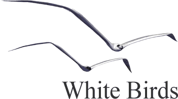

Video game studio (mainly adventure and point & click games). I joined as a final-year intern and stayed 5 years: junior developer, then Lead Dev from 2007.

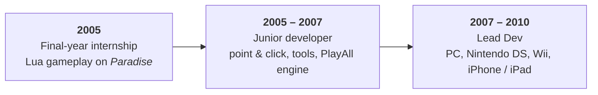

### Key figures
| | |
|---|---|
| 🏆 | ***Nikopol***: Best Graphics award at the **Milthon 2008** (French video game festival) |
| 📱 | ***Cardboard Castle***: **top 5 on the French App Store** |
| 🎮 | Games shipped on **5 platforms**: PC, Nintendo DS, Nintendo Wii, iPhone, iPad |
| 👥 | Team of up to **5 people** on *Aztec Treasure Hunt* (3 integrators, 1 engine programmer, 1 gameplay programmer) |

### Lead Dev (2007 – May 2010)

#### *Nikopol* (PC), Best Graphics at the Milthon 2008

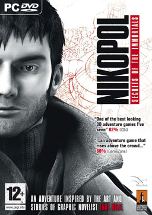

- Export tool for the "warps" used by the 360° view (**C++ / MFC**)
- Gameplay programming in **Lua**
- Special effects in **HLSL pixel shaders**
- Set up the team and the production pipeline with an external studio (**MZone**)

Credited *Lead Programmer* · [MobyGames page](https://www.mobygames.com/game/36518/nikopol-secrets-of-the-immortals/)

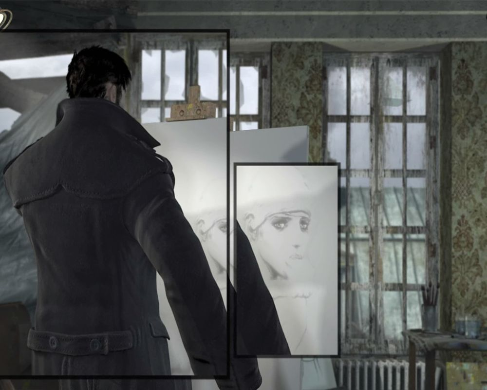

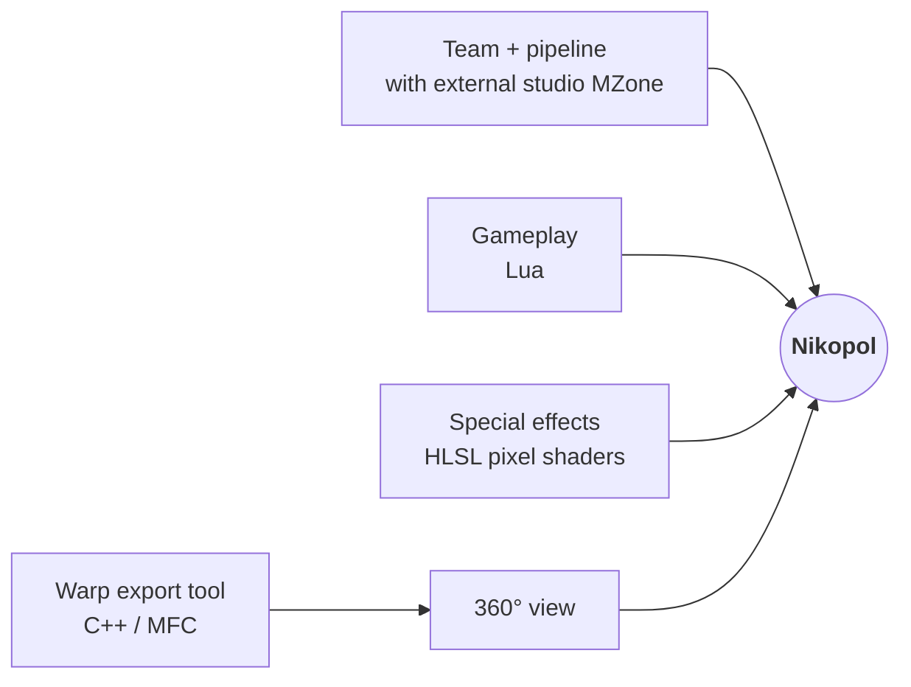

#### *Kate Brooks' Adventure* (PC), hidden object game

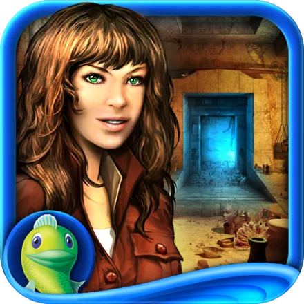

- PC hidden object game in three chapters
- Set up the team and the pipeline

Credited *Lead Programmer* · [MobyGames page](https://www.mobygames.com/game/253218/the-secret-legacy-a-kate-brooks-adventure/)

#### Nintendo DS

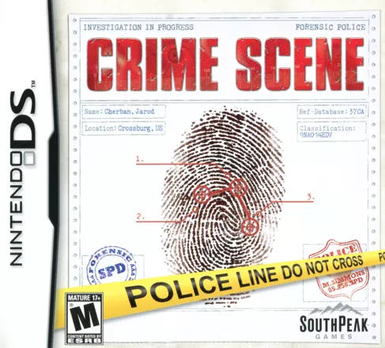

- ***Let's Play Fashion Designer***: project management through to delivery, developed in **C** with **256 KB** of memory (tight memory management)
- ***Tower Defense***: isometric display, pathfinding
- ***Nikopol DS***: 360° display on the DS
- Prototype of a 2D puzzle game in the style of *Professor Layton* (**C++**)
- ***Crime Scene*** (2010): credited *Additional Programming* · [MobyGames page](https://www.mobygames.com/game/69016/crime-scene/)

#### Nintendo Wii: *Aztec Treasure Hunt*
- 2D point & click with 3D tools
- Handled the **Wii TRC** (Nintendo certification requirements)
- Team of 5: 3 integrators, 1 engine programmer, 1 gameplay programmer

#### iPhone / iPad

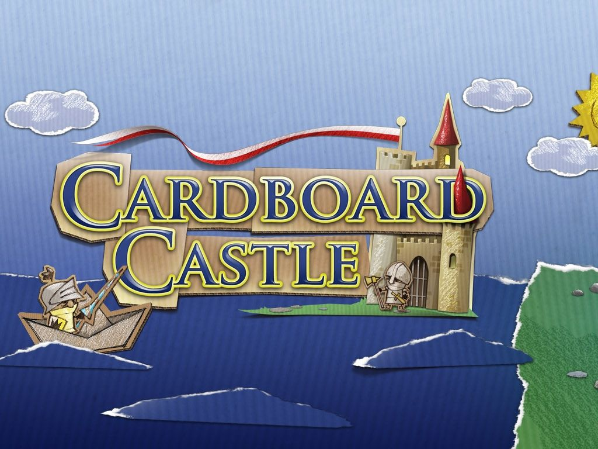

- ***Cardboard Castle*** (**Xcode + Lua**): top 5 on the French App Store · credited *Lead Programmer* · [MobyGames page](https://www.mobygames.com/game/55729/cardboard-castle/)
- ***Last King of Africa***: adaptation of *Paradise*

 

### Junior developer (May 2005 – October 2007)

#### Final-year internship (May – September 2005): *Paradise*

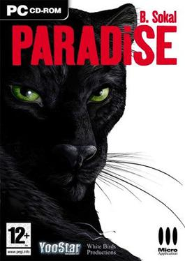

- Gameplay programming in **Lua** on the in-house 2D/3D engine **Opalium** (object-oriented and event-driven programming)
- Fishing mini-game (inertia, random movements), cameras following a character
- Worked with Slovenian subcontractors through a source control system

Credited *Programming* · [MobyGames page](https://www.mobygames.com/game/22233/paradise/)

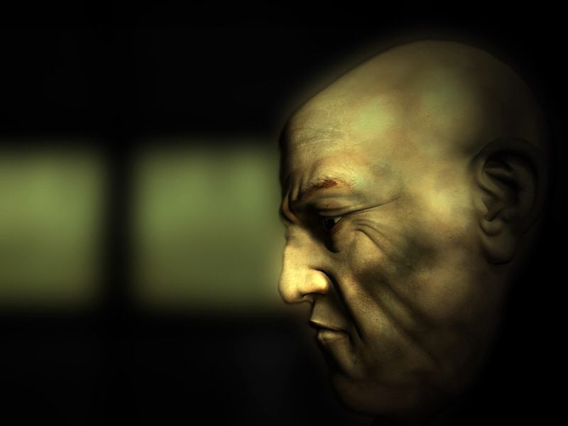

#### Point & click games

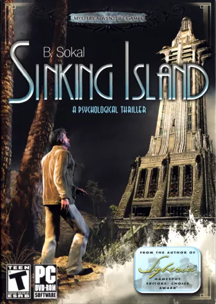

- ***Paradise*** and ***Martine 1 & 2*** (edutainment games): in-house engine, **Lua** scripts
- ***Sinking Island*** (PC, 2007): credited *Programming* · [MobyGames page](https://www.mobygames.com/game/30685/sinking-island/)

#### Tools and engine
- Asset export tools in **C++** and production pipelines
- Contributed to the multiplatform 3D engine ***PlayAll*** (PS3, Xbox 360, PC, C++), shared by several companies; prototype of a point & click system

 

### Takeaways
- **Close work with game designers**, especially on adventure games
- **Strong hardware constraints**: 256 KB of memory on the DS, Nintendo certification (Wii TRC)
- **Multiplatform production**: adapting a game from one platform to another (*Paradise* → *Last King of Africa* on iPhone / iPad, *Nikopol* → *Nikopol DS*)
- **First lead roles**: building teams, pipelines with external studios, project management through to delivery

### Summary by platform
| Platform | Games | Tech |
|---|---|---|
| PC | *Paradise*, *Martine 1 & 2*, *Sinking Island*, *Nikopol*, *Kate Brooks' Adventure* | In-house engine, Lua, C++ / MFC, HLSL |
| Nintendo DS | *Let's Play Fashion Designer*, *Tower Defense*, *Nikopol DS*, *Crime Scene*, puzzle prototype | C, C++ |
| Nintendo Wii | *Aztec Treasure Hunt* | Wii TRC |
| iPhone / iPad | *Cardboard Castle*, *Last King of Africa* | Xcode, Lua |
| PS3, Xbox 360, PC | *PlayAll* engine (contribution) | C++ |

[← Previous period: Education (2000–2005)](formation.md) · Next period: [Mando Productions (2010–2016) →](mando.md)

## References
Public credits on MobyGames:
- [Fabien Simon's MobyGames profile](https://www.mobygames.com/person/759004/fabien-simon/)
- [*Nikopol: Secrets of the Immortals*](https://www.mobygames.com/game/36518/nikopol-secrets-of-the-immortals/) (2008): Lead Programmer
- [*The Secret Legacy: A Kate Brooks Adventure*](https://www.mobygames.com/game/253218/the-secret-legacy-a-kate-brooks-adventure/) (2011): Lead Programmer
- [*Cardboard Castle*](https://www.mobygames.com/game/55729/cardboard-castle/) (2011): Lead Programmer
- [*Crime Scene*](https://www.mobygames.com/game/69016/crime-scene/) (2010): Additional Programming
- [*Sinking Island*](https://www.mobygames.com/game/30685/sinking-island/) (2007): Programming
- [*Paradise*](https://www.mobygames.com/game/22233/paradise/) (2006): Programming

---
Images: logo and Nikopol / Paradise box art from Wikipedia; other box art and screenshots from MobyGames. Trademarks and artwork belong to their respective owners.
