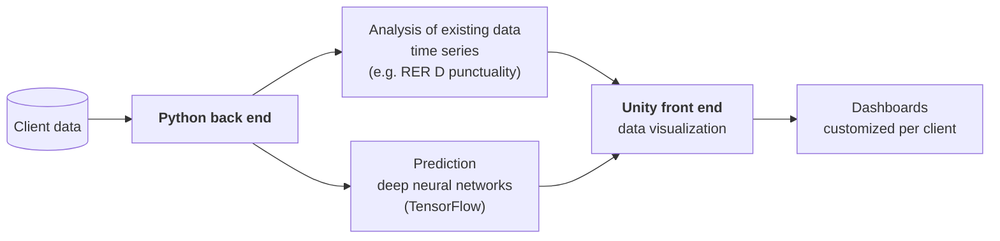

# Your Data Consulting (2016–2019) – Fabien Simon

[← Portfolio home](../en.md) · [Version française](../fr/your-data.md)

**CTO, May 2016 – May 2019.** Technical lead of *Livejourney*, a real-time data visualization and analytics solution with AI-based prediction algorithms. I led a team of 3 developers.

### Key figures
| | |
|---|---|
| 🧭 | **CTO** role: technical lead of the *Livejourney* solution |
| 👥 | Team of **3 developers** |
| 🏢 | Clients: **SNCF (RER D)**, **Veepee**, **ID Logistics**, **KPMG** |

### *Livejourney*: architecture

### What I did
- **Technical lead** of the solution and management of a team of 3 developers
- **Architecture**: **Unity** front end, **Python** back end, AI prediction algorithms

#### Predictive AI
- Forecasting upcoming needs with **deep neural networks** (**TensorFlow**):
  - upcoming orders
  - equipment maintenance

#### Data analysis
- Working with **time series** to inform the clients' strategic decisions:
  - **train punctuality**: measuring delays on the **RER D** line (SNCF, Paris region commuter rail)
  - customer service processing times

#### BI
- Designed **custom dashboards** tailored to each client's needs

### Takeaways
- **First CTO role**: responsible for all the technology of a product
- **From data to decisions**: analysis, prediction, then visual reporting for the clients' decision-makers
- **Applied AI**: deep neural networks serving concrete business cases
- **Unity beyond games**: a real-time 3D engine used for data visualization

---
Previous period: [← Mando Productions (2010–2016)](mando.md) · Next period: [Manzalab (2019–2026) →](manzalab.md)
