# Portfolio détaillé – Fabien Simon

[English version](en.md) · [← Retour au profil](../README.md) · [Mes crédits sur MobyGames](https://www.mobygames.com/person/759004/fabien-simon/)

Tech Lead Fullstack .NET / C# & IA, plus de 20 ans de développement logiciel, dont 11 ans dans le jeu vidéo (2005–2016).

## Sommaire
- [White Birds Productions (2005–2010)](#white-birds-productions-20052010)
- *À venir : Mando Productions (2010–2016), Your Data Consulting (2016–2019), Manzalab (2019–2026), formation*

---

## White Birds Productions (2005–2010)

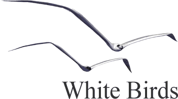

Studio de jeux vidéo (notamment jeux d'aventure et point & click). J'y suis entré en stage de fin d'études, puis j'y suis resté 5 ans : développeur junior, puis Lead Dev à partir de 2007.

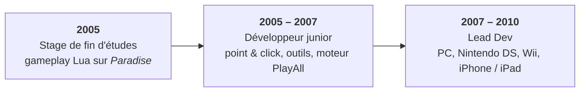

### En chiffres
| | |
|---|---|
| 🏆 | ***Nikopol*** : prix du meilleur graphisme aux **Milthon 2008** (Festival du jeu vidéo) |
| 📱 | ***Cardboard Castle*** : **top 5 App Store France** |
| 🎮 | Jeux livrés sur **5 plateformes** : PC, Nintendo DS, Nintendo Wii, iPhone, iPad |
| 👥 | Équipe jusqu'à **5 personnes** sur *Aztec Treasure Hunt* (3 intégrateurs, 1 codeur moteur, 1 codeur gameplay) |

### Lead Dev (2007 – mai 2010)

#### *Nikopol* (PC), prix du meilleur graphisme aux Milthon 2008

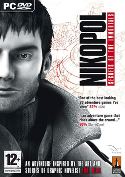

- Outil d'export des « warps » pour la vue à 360° (**C++ / MFC**)
- Programmation du gameplay en **Lua**
- Effets spéciaux en **pixel shaders HLSL**
- Mise en place de l'équipe et du pipeline de production avec un studio externe (**MZone**)

Crédité *Lead Programmer* · [fiche MobyGames](https://www.mobygames.com/game/36518/nikopol-secrets-of-the-immortals/)

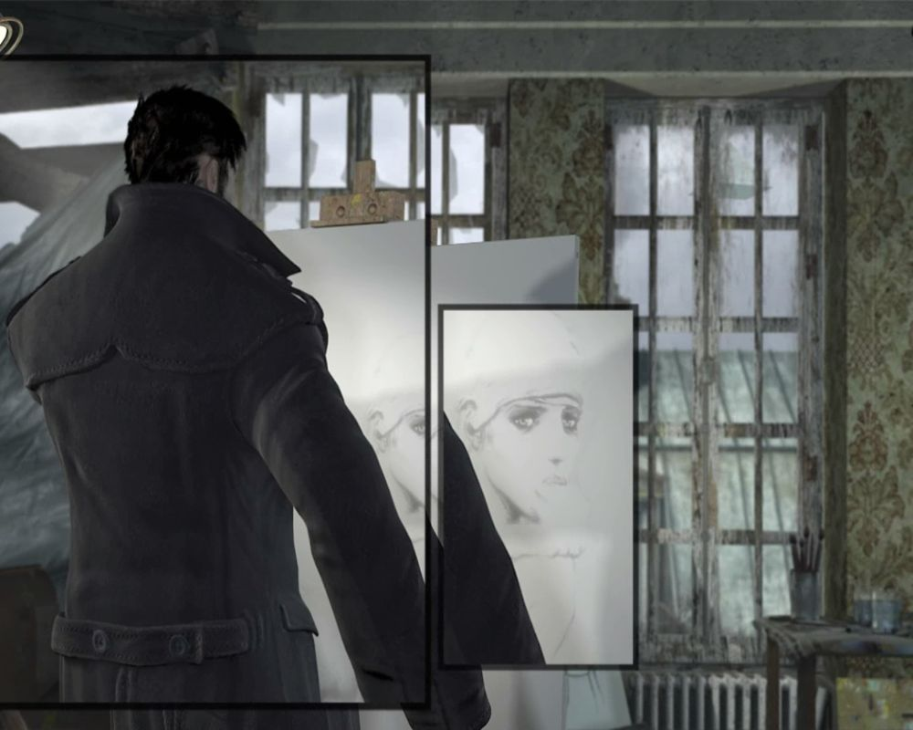

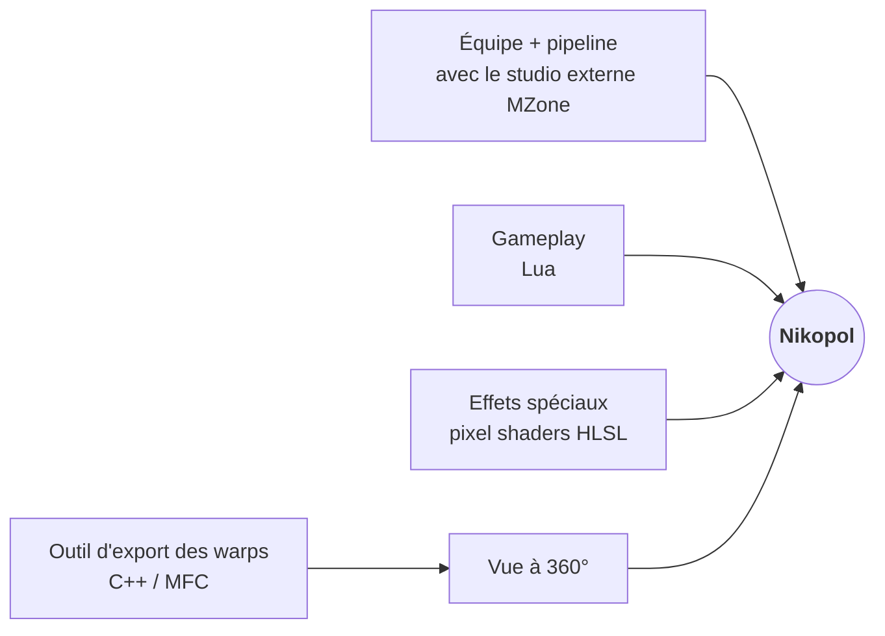

#### *Kate Brooks' Adventure*, jeu d'objets cachés cross-platform

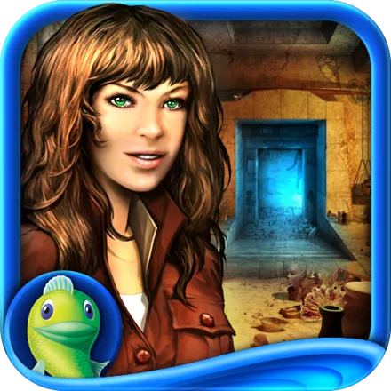

- Jeu PC d'objets cachés en trois chapitres, décliné sur Wii, iPad et iPhone
- Mise en place de l'équipe et du pipeline

Crédité *Lead Programmer* · [fiche MobyGames](https://www.mobygames.com/game/253218/the-secret-legacy-a-kate-brooks-adventure/)

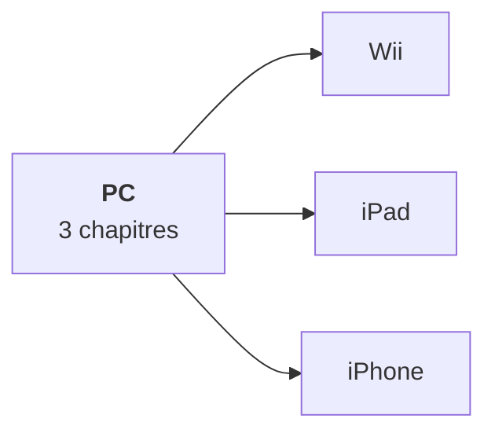

#### Nintendo DS

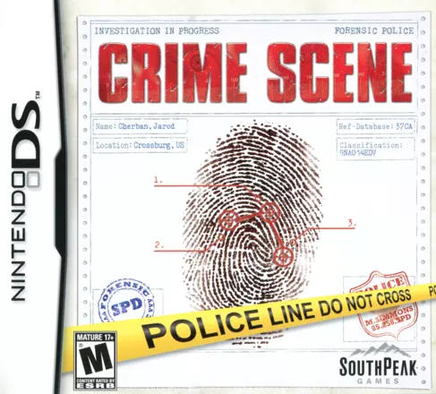

- ***Let's Play Fashion Designer*** : gestion de projet jusqu'à la livraison, développement en **C** avec une mémoire de **256 Ko** (gestion fine de la mémoire)
- ***Tower Defense*** : affichage isométrique, pathfinding
- ***Nikopol DS*** : affichage à 360° sur DS
- Prototype de jeu d'énigmes 2D façon *Professeur Layton* (**C++**)
- ***Crime Scene*** (2010) : crédité *Additional Programming* · [fiche MobyGames](https://www.mobygames.com/game/69016/crime-scene/)

#### Nintendo Wii : *Aztec Treasure Hunt*
- Point & click 2D avec des outils en 3D
- Gestion des **TRC Wii** (exigences de certification de Nintendo)
- Équipe de 5 : 3 intégrateurs, 1 codeur moteur, 1 codeur gameplay

#### iPhone / iPad

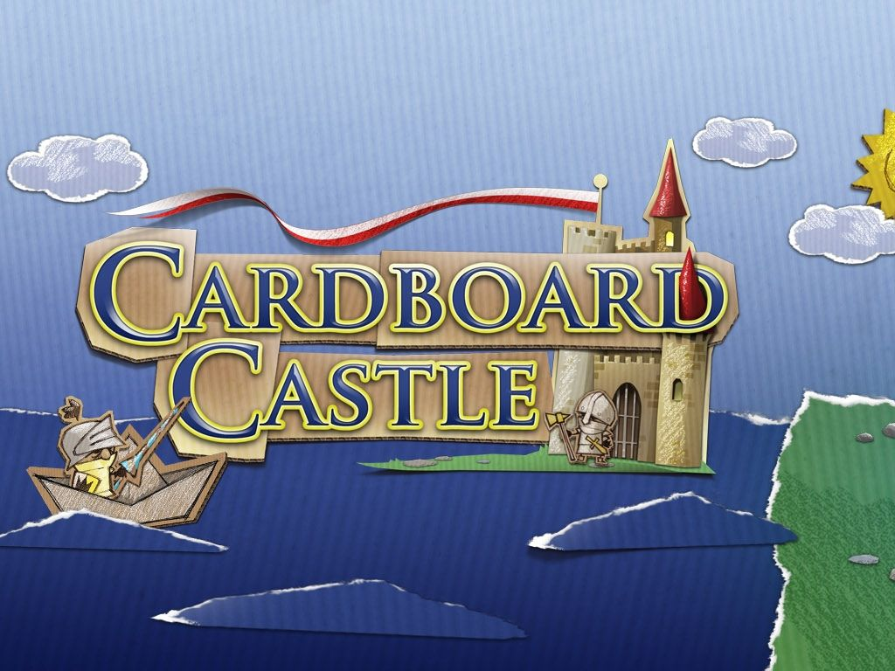

- ***Cardboard Castle*** (**Xcode + Lua**) : top 5 App Store France · crédité *Lead Programmer* · [fiche MobyGames](https://www.mobygames.com/game/55729/cardboard-castle/)
- ***Last King of Africa*** : adaptation de *Paradise*

 

### Développeur junior (mai 2005 – octobre 2007)

#### Stage de fin d'études (mai – septembre 2005) : *Paradise*

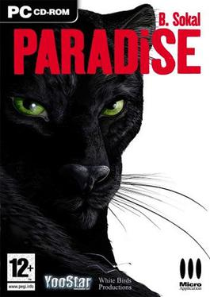

- Programmation du gameplay en **Lua** sur le moteur 2D/3D maison **Opalium** (programmation objet et événementielle)
- Mini-jeu de pêche (inertie, mouvements aléatoires), caméras qui suivent un personnage
- Travail avec des sous-traitants slovènes via un gestionnaire de sources

Crédité *Programming* · [fiche MobyGames](https://www.mobygames.com/game/22233/paradise/)

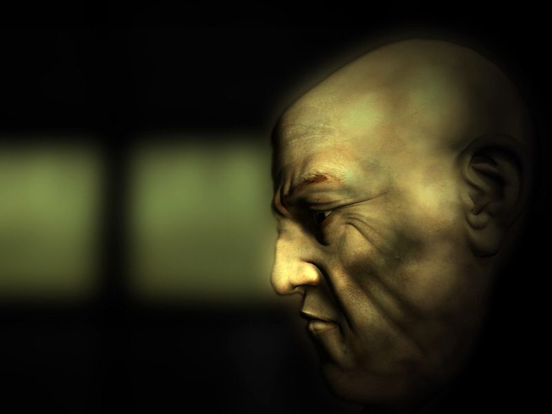

#### Jeux point & click

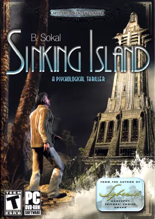

- ***Paradise*** et ***Martine 1 & 2*** (jeux ludo-éducatifs) : moteur maison, scripts **Lua**
- ***Sinking Island*** (PC, 2007) : crédité *Programming* · [fiche MobyGames](https://www.mobygames.com/game/30685/sinking-island/)

#### Outils et moteur
- Outils d'export d'assets en **C++** et pipelines de production
- Participation au moteur 3D multiplateforme ***PlayAll*** (PS3, Xbox 360, PC, C++), commun à plusieurs entreprises ; prototype d'un système de point & click

 

### Ce que j'en retiens
- **Travail étroit avec les game designers**, énormément sur les jeux d'aventure
- **Contraintes matérielles fortes** : 256 Ko de mémoire sur DS, certification Nintendo (TRC Wii)
- **Production multiplateforme** : un même jeu décliné sur PC, Wii, iPad et iPhone
- **Premiers rôles de lead** : constitution d'équipes, pipelines avec des studios externes, gestion de projet jusqu'à la livraison

### Récapitulatif par plateforme
| Plateforme | Jeux | Technos |
|---|---|---|
| PC | *Paradise*, *Martine 1 & 2*, *Sinking Island*, *Nikopol*, *Kate Brooks' Adventure* | Moteur maison, Lua, C++ / MFC, HLSL |
| Nintendo DS | *Let's Play Fashion Designer*, *Tower Defense*, *Nikopol DS*, *Crime Scene*, prototype d'énigmes | C, C++ |
| Nintendo Wii | *Aztec Treasure Hunt*, *Kate Brooks' Adventure* | TRC Wii |
| iPhone / iPad | *Cardboard Castle*, *Last King of Africa*, *Kate Brooks' Adventure* | Xcode, Lua |
| PS3, Xbox 360, PC | Moteur *PlayAll* (participation) | C++ |

## Références
Crédits publics sur MobyGames :
- [Profil de Fabien Simon sur MobyGames](https://www.mobygames.com/person/759004/fabien-simon/)
- [*Nikopol: Secrets of the Immortals*](https://www.mobygames.com/game/36518/nikopol-secrets-of-the-immortals/) (2008) : Lead Programmer
- [*The Secret Legacy: A Kate Brooks Adventure*](https://www.mobygames.com/game/253218/the-secret-legacy-a-kate-brooks-adventure/) (2011) : Lead Programmer
- [*Cardboard Castle*](https://www.mobygames.com/game/55729/cardboard-castle/) (2011) : Lead Programmer
- [*Crime Scene*](https://www.mobygames.com/game/69016/crime-scene/) (2010) : Additional Programming
- [*Sinking Island*](https://www.mobygames.com/game/30685/sinking-island/) (2007) : Programming
- [*Paradise*](https://www.mobygames.com/game/22233/paradise/) (2006) : Programming

---
Visuels : logo et jaquettes de Nikopol et Paradise issus de Wikipédia ; autres jaquettes et captures issues de MobyGames. Marques et illustrations appartenant à leurs ayants droit.
