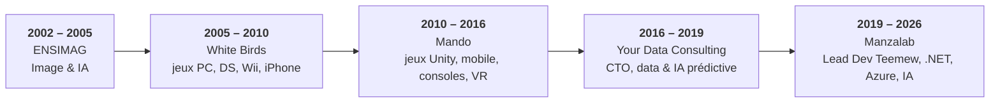

# Portfolio détaillé – Fabien Simon

[English version](en.md) · [← Retour au profil](../README.md) · [Mes crédits sur MobyGames](https://www.mobygames.com/person/759004/fabien-simon/)

Tech Lead Fullstack .NET / C# & IA. Plus de 20 ans de développement logiciel, dont 11 ans dans le jeu vidéo, et environ 19 ans en position de lead.

## Les périodes

| Période | Rôle | En bref | Page |
|---|---|---|---|
| 2005 – 2010 | Développeur junior, puis Lead Dev | Jeux d'aventure PC, Nintendo DS et Wii, iPhone ; *Nikopol*, prix du meilleur graphisme aux Milthon 2008 | [White Birds Productions](fr/white-birds.md) |
| 2010 – 2016 | Lead Dev | Jeux Unity et mobiles, *Babel Rising 3D* sur PS3, Xbox 360 et Oculus Rift | [Mando Productions](fr/mando.md) |
| 2016 – 2019 | CTO | Plateforme de datavisualisation *Livejourney*, IA prédictive | [Your Data Consulting](fr/your-data.md) |
| 2019 – 2026 | Lead Dev | Plateforme 3D web *Teemew* : .NET, Azure, temps réel, IA | *à venir* |
| 2002 – 2005 | Formation | ENSIMAG (Image & IA), échange à l'Université de Waterloo | *à venir* |
