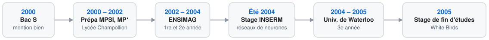
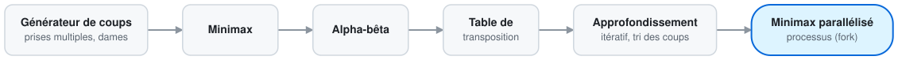
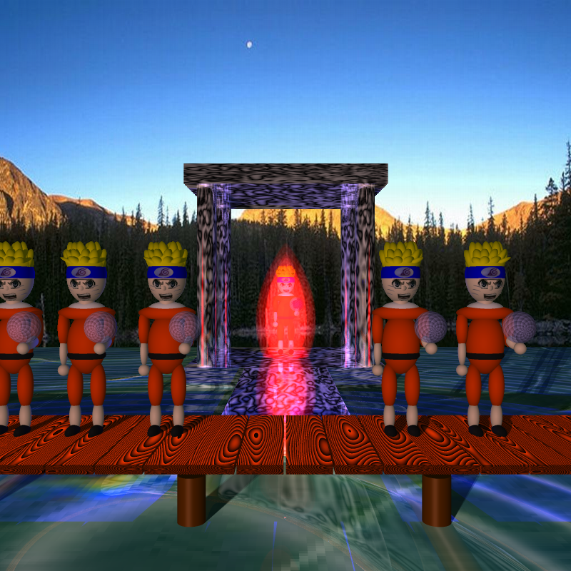
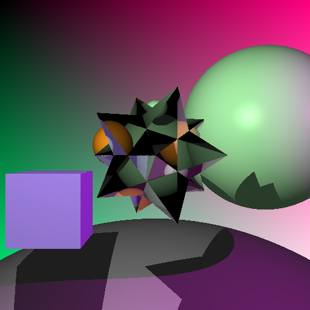
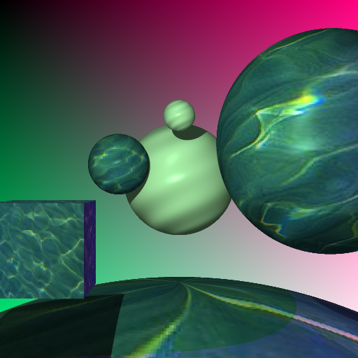
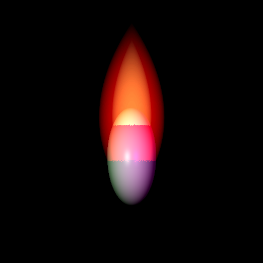
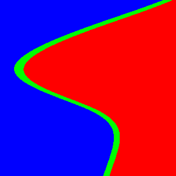

# Formation (2000–2005) – Fabien Simon

[← Accueil du portfolio](../fr.md) · [English version](../en/formation.md)

**Ingénieur ENSIMAG** (Grenoble INP), diplômé en 2005, spécialisation **Image et Intelligence Artificielle**, avec une 3e année en échange à l'**Université de Waterloo** (Ontario, Canada).

### Projets marquants
| Projet | Année | Ce que j'ai fait |
|---|---|---|
| **Jeu de dames avec IA** | 2004 | C++, IA minimax puis alpha-bêta, table de transposition, approfondissement itératif, minimax parallélisé |
| **Compilateur mini-Pascal** | 2004 | Compilateur vers l'assembleur en Ada, en équipe de 4 (120 h) |
| **Suivi de visage** | 2004 | Pilotage d'une caméra mobile en C++ qui suit automatiquement un visage |
| **Ray tracer** | 2004 | C++ (Waterloo) : réflexions et réfractions récursives, textures procédurales, bump mapping, simulation de flamme, scène finale animée (voir plus bas) |
| **Processeur 8 bits** | 2003 | Conception d'un processeur microprogrammé |
| **Assembleur** | 2003 | Assembleur en C pour Linux |
| **Digital Eyes** | 2003–2004 | Projet de création d'entreprise : réalité augmentée pour les musées ; dirigeant désigné |

#### Zoom : l'IA du jeu de dames

#### Zoom : le ray tracer de Waterloo (CS 488, 2004)
Ray tracer écrit en C++, appelé depuis Python. Le projet final consistait à rendre une scène inspirée du manga *Naruto*, en réutilisant la marionnette articulée (modèle hiérarchique) d'un devoir précédent.

| | |
|:---:|:---:|
|  Scène finale (aussi rendue en vidéo animée) |  Réflexion + réfraction récursives sur un maillage |
|  Bump mapping, textures et antialiasing |  Simulation de flamme |

- **Primitives et maillages**, modèles hiérarchiques
- **Réflexions récursives** et **réfractions** (indices réglables), combinables
- **Textures** : à partir d'une image, procédurales (bois, damier, **bruit de Perlin**) et combinaisons des deux
- **Bump mapping** et **antialiasing**
- **Caméra fish-eye** (180° et 360°)
- **Simulation de flamme** (de 50 à 500 points) et rendu de **vidéos animées**
- Optimisation du temps de calcul

### ENSIMAG, 1re année (2002–2003)
- **Maths appliquées** : analyse, probabilités, calcul scientifique (Matlab), recherche opérationnelle et optimisation combinatoire, théorie des langages
- **Informatique** : algorithmique et structures de données, logique, réseaux
- **Architecture matérielle** : conception d'un **processeur 8 bits microprogrammé** ; logiciel de base : **assembleur en C pour Linux**
- TP en **Ada** (grammaires, reconnaissance de langages) et en **Java** (automates)

### ENSIMAG, 2e année, profil Image (2003–2004)
- **Cours** : compilation, bases de données, systèmes d'exploitation et programmation concurrente, statistiques, modélisation géométrique, complexité et parallélisme, systèmes intelligents, **réseaux de neurones**, **traitement de l'image**, cryptographie, création d'entreprise
- **Projet génie logiciel** : **compilateur mini-Pascal → assembleur en Ada** (analyse lexicale, syntaxique, contextuelle, génération de code), versionné avec CVS, avec documentation de conception, plan de tests et bilan
- **Jeu de dames en C++** avec IA (voir le schéma plus haut)
- **Systèmes** : processus, pipes, **threads POSIX**, **MPI**, allocateur mémoire en C
- **Bases de données** : logiciel de gestion de comptes clients pour opérateurs téléphoniques en **Java + MySQL** (JDBC)
- **Modélisation géométrique** (Matlab) : courbes de Bézier, B-splines, moindres carrés, Levenberg-Marquardt
- **IA** : réseaux de neurones avec **R**, systèmes experts en **CLIPS**
- **Projet de fin d'année** : suivi de visage et pilotage d'une caméra en C++ (détection de la peau par histogramme et loi gaussienne, localisation du visage, asservissement de la caméra)
- **Digital Eyes** (4 élèves) : lunettes de réalité augmentée pour les musées, les entreprises et les laser games ; business plan, étude de marché et de prix ; j'étais le **dirigeant désigné**

### Stage INSERM (été 2004)
Unité U594 (neuro-imagerie), 8 semaines, dans le cadre du projet européen *e-tumour*.

- **Toolbox C++ de classification de tumeurs cérébrales** à partir d'IRM
- Réseaux de neurones à une ou plusieurs couches cachées, pyramidaux, « distance-based »
- Rétropropagation, régularisation (decay), validation croisée
- Rapport rédigé en anglais
- Ci-contre : une frontière de décision apprise par un réseau de neurones lors des tests de la toolbox

 

### Université de Waterloo, Canada (septembre 2004 – avril 2005)
| Cours | Contenu |
|---|---|
| **CS 488 – Computer Graphics** | OpenGL, modèles hiérarchiques (marionnette articulée, trackball), modules C++ appelés depuis Python ; **projet ray tracer** (voir le zoom plus haut) |
| **CS 787 – Computational Vision** (graduate) | Détection de coins, filtres de Gabor, stéréo photométrique, estimation robuste, carte de disparité stéréo ; projet *shape from texture* |
| **SYDE 372 – Pattern Recognition** | Classifieurs MED, MICD, MAP, plus proche voisin, clustering |
| **SYDE 558 – Fuzzy Logic and Neural Networks** | Logique floue et réseaux de neurones |
| **CS 466 – Algorithm Design and Analysis** | Conception et analyse d'algorithmes |

Tous les cours et rapports en anglais.

### Langages et outils vus pendant les études
C, C++, Ada, Java, Python, SQL, Matlab, R, CLIPS, shell Unix, HTML, assembleur ; CVS, LaTeX, gdb, Unix / Linux.

### Enseignement
- **ESGI**, pendant **3 ans** : cours de **traitement d'image** (Bac+4)
- **ICAN** : présentation du langage de script **Lua** (Bac+3)
- Cours particuliers de maths et de physique, niveau terminale (2003)

### Ce que j'en retiens
- **L'IA dès 2004** : réseaux de neurones en stage à l'INSERM, systèmes experts, logique floue, reconnaissance de formes
- **L'image sous toutes ses formes** : synthèse (ray tracing, OpenGL), analyse (vision par ordinateur), et plus tard l'enseignement du traitement d'image
- **Les bases bas niveau** : processeur, assembleur, compilateur, systèmes, programmation concurrente
- **Une année à l'étranger** : cours de niveau graduate et travail entièrement en anglais

---
Période suivante : [White Birds Productions (2005–2010) →](white-birds.md)
