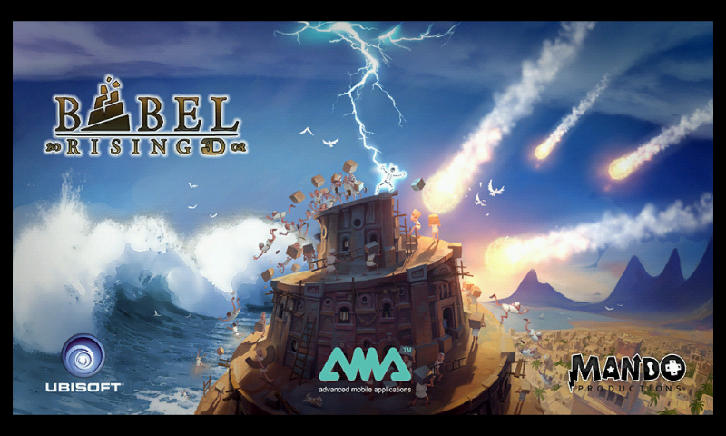
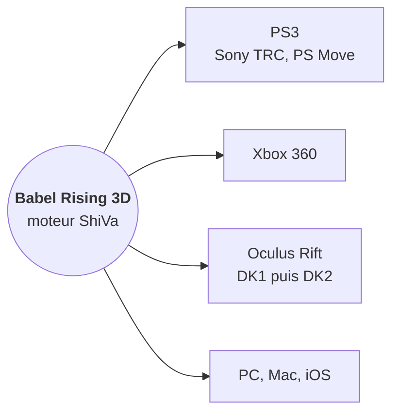
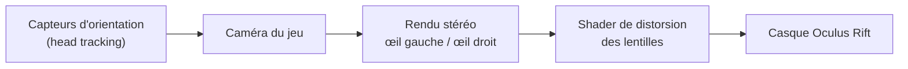
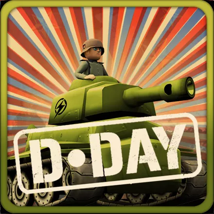
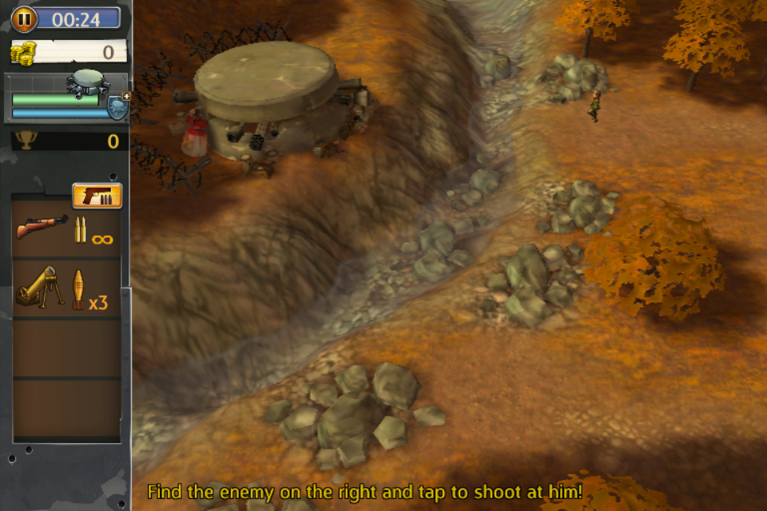

# Mando Productions (2010–2016) – Fabien Simon

[← Accueil du portfolio](../fr.md) · [English version](../en/mando.md) · [Mes crédits sur MobyGames](https://www.mobygames.com/person/759004/fabien-simon/)

**Lead Dev, juin 2010 – avril 2016.** Studio de jeux vidéo : jeux Unity et mobiles, consoles, réalité virtuelle et R&D (réalité augmentée, vision sur mobile). J'y ai encadré des équipes de 1 à 7 personnes, en travaillant main dans la main avec les game designers.

### En chiffres
| | |
|---|---|
| 📲 | **1 à 3 millions** de téléchargements cumulés sur les jeux mobiles |
| 🥽 | ***Babel Rising 3D*** : dans le lineup des **10 premiers jeux du store Oculus Rift** |
| 🎮 | ***Babel Rising 3D*** sorti sur **PS3** et **Xbox 360**, porté sur PC, Mac et iOS |
| 👥 | Équipes de **1 à 7 personnes** |

### *Babel Rising 3D* : consoles et réalité virtuelle

- Développé avec le moteur **ShiVa**
- Sorti sur **PS3** (conformité **Sony TRC**, **PS Move**) et **Xbox 360**
- Portages **PC, Mac et iOS**
- Crédité *Programming* · [fiche MobyGames](https://www.mobygames.com/game/57700/babel-rising-3d/)

#### Portage sur Oculus Rift (DK1 puis DK2)
Le jeu faisait partie du lineup des 10 premiers jeux du store Oculus. Le SDK d'origine était très bas niveau : presque tout a été fait à la main.
- **Intégration du SDK à la main en C++** dans le moteur
- **Rendu stéréo** et **shader de distorsion des lentilles** écrits à la main
- **Head tracking** : lecture des capteurs d'orientation et application à la caméra
- Travail sur la **latence** et le **framerate** pour limiter le mal des transports

### Jeux Unity (C#)

- ***Hills of Glory 3D*** : iOS, Android, PC, Mac · crédité *Programming* · [fiche MobyGames](https://www.mobygames.com/game/126860/hills-of-glory-3d/)
- ***Babel Casino*** : jeu Facebook
- ***Runner Ocean's Run*** : jeu mobile, partie réseau social avec intégration du **SDK Facebook**
- Plusieurs **serious games** pour des entreprises et des associations
- Divers prototypes

### Applications mobiles et SDK
- ***Strip Messenger*** : application **iOS native** (iOS SDK, **Objective-C**), messagerie temps réel façon bande dessinée ; fonctions spécifiques à l'iPhone : caméra, carnet d'adresses, interface clavier
- **SDK d'achats in-app iOS** intégré puis déployé sur **tous les jeux du studio**
- **SDK Facebook**
- Nombreux SDK mobiles : achats in-app, leaderboards, réseaux sociaux, régies publicitaires (Java pour certains SDK)

### R&D : réalité augmentée, vision et réalité virtuelle
- **Vérification de billets de banque par détection d'hologramme** sur mobile (billets d'un pays étranger)
- **Scan AR d'étiquettes de rhum de luxe** pour vérifier leur authenticité
- Réalité augmentée sur mobile : lecture de **QR codes** par la caméra
- R&D sur **casques VR** : prototypes, visites virtuelles, photos 360° et 3D
- ***Visiwyg*** : solution de visite de logements sur casque VR et sur le web (**WPF, XAML**)

### Ce que j'en retiens
- **Passage à Unity et au C#**, devenu ma techno principale pendant 15 ans
- **Contraintes consoles** : certification Sony (TRC) sur PS3, sortie Xbox 360
- **VR des débuts** : un SDK bas niveau intégré à la main, rendu stéréo et lutte contre la latence
- **Mobile à grande échelle** : millions de téléchargements, SDK de monétisation déployés sur tout le catalogue
- **R&D appliquée** : vision par ordinateur et réalité augmentée sur mobile

### Récapitulatif par plateforme
| Plateforme | Projets | Technos |
|---|---|---|
| iOS | *Hills of Glory 3D*, *Strip Messenger*, portage *Babel Rising 3D*, jeux mobiles | Unity C#, Objective-C, SDK in-app |
| Android | *Hills of Glory 3D*, jeux mobiles | Unity C#, Java (SDK) |
| PC, Mac | *Hills of Glory 3D*, portages *Babel Rising 3D* | Unity C#, ShiVa |
| PS3 | *Babel Rising 3D* | ShiVa, Sony TRC, PS Move |
| Xbox 360 | *Babel Rising 3D* | ShiVa |
| VR | *Babel Rising 3D* sur Oculus Rift, *Visiwyg*, prototypes | C++, WPF / XAML |
| Facebook | *Babel Casino* | Unity C#, SDK Facebook |

[← Période précédente : White Birds Productions (2005–2010)](white-birds.md)

## Références
Crédits publics sur MobyGames :
- [Profil de Fabien Simon sur MobyGames](https://www.mobygames.com/person/759004/fabien-simon/)
- [*Babel Rising 3D*](https://www.mobygames.com/game/57700/babel-rising-3d/) (2012) : Programming
- [*Hills of Glory 3D*](https://www.mobygames.com/game/126860/hills-of-glory-3d/) (2013) : Programming

---
Visuels issus de MobyGames. Marques et illustrations appartenant à leurs ayants droit.
