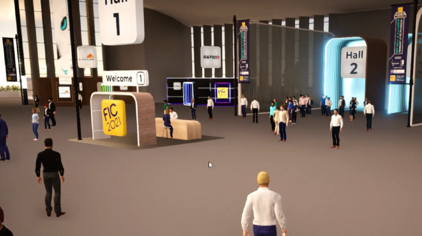
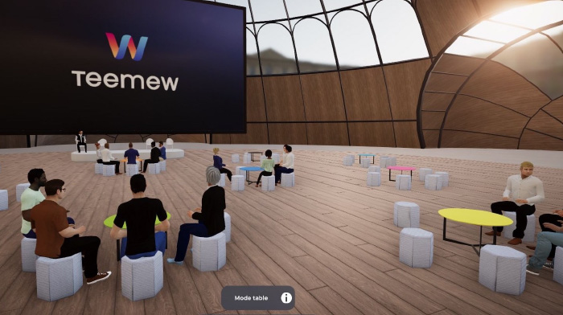
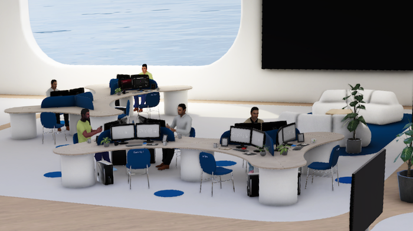
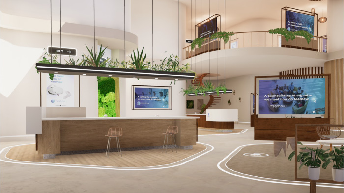
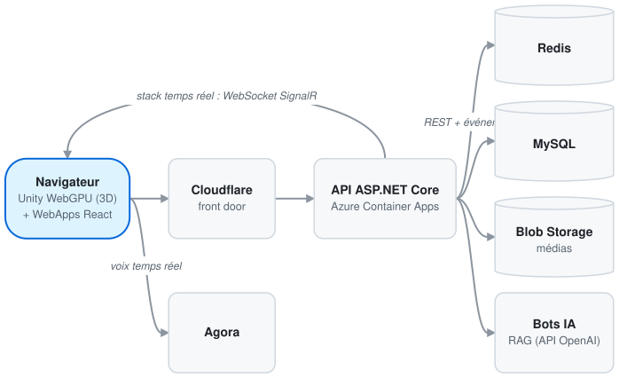
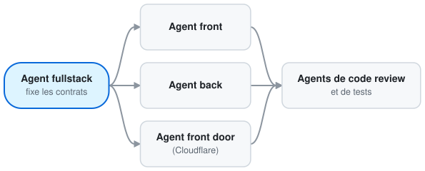
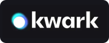

# Manzalab (2019–2026) – Fabien Simon

[← Accueil du portfolio](../fr.md) · [English version](../en/manzalab.md)

**Lead Dev, juin 2019 – mai 2026.** Lead de l'équipe fullstack (5 développeurs) de **Teemew**, une plateforme 100 % web d'événements virtuels, d'exposition d'œuvres et de discussion audio en temps réel dans un univers 3D. J'étais garant de l'architecture, « de la base de données à l'affichage 3D dans le navigateur ».

### En chiffres
| | |
|---|---|
| 👥 | Jusqu'à **2 000 utilisateurs simultanés** sur un même événement ; auditorium jusqu'à **1 000 personnes** |
| ⚡ | Environnement 3D chargé dans le navigateur en **moins de 10 secondes** |
| 🏢 | Une **vingtaine de clients principaux** : La Poste, SNCF, SFR, Sopra Steria, France Travail, April… |
| 🎟️ | *Village Numérique* de Pôle Emploi : **15 000 inscrits** ; onboarding Sopra Steria : **500 nouveaux collaborateurs par mois** |
| 🎤 | **VIRTUALITY** (décembre 2020) : événement que j'ai organisé, environ **1 500 participants** |
| 🌍 | Plateforme disponible en **9 langues**, sur PC / Mac (web) et en VR |

### Teemew en images
| | |
|:---:|:---:|
|  Forum International de la Cybersécurité (FIC 2021) |  Auditorium et sessions en tables |
|  Bureaux virtuels |  Showroom |

### Architecture

### Back-end .NET (6 ans en production)
- **API ASP.NET Core** (.NET 8 puis .NET 10), **Entity Framework Core** (migrations), **LINQ**, **MySQL** (Azure Database for MySQL)
- **Deux stacks complémentaires** :
  - **asynchrone** : API REST et événements **Redis** (Redis Streams avec consumer groups, Pub/Sub en request-reply avec timeout)
  - **synchrone temps réel** : **SignalR** (WebSocket, sérialisation MessagePack, **Azure SignalR Service**, Redis en backplane) pour les positions des avatars et le partage de documents ; voix temps réel avec **Agora**
- **Microservice d'upload event-driven** en .NET 10 (Minimal APIs), multi-tenant : conception et développement de tout le flux, fichiers jusqu'à 2 Go
- **Multi-tenant** : tenant résolu par l'émetteur du JWT, stockage et clés Redis par tenant
- Authentification : **ASP.NET Core Identity** (cookie, backoffice), **JWT**, clé d'API
- **API Stripe** en .NET pour les abonnements des galeries virtuelles
- Outillage : Swagger / OpenAPI, health checks (MySQL, Redis, SignalR), rate limiting, AutoMapper, tests **NUnit**, SendGrid, exports Excel / CSV / iCalendar

### IA dans le produit
- **Bots IA audio et chat textuel** branchés sur un **RAG** (API OpenAI), avec transcription **speech-to-text**
- Exemple : les galeristes renseignent les informations de leurs œuvres, et un **avatar virtuel** répond aux visiteurs en leur absence

### Développement avec agents IA (Claude Code)
- **Multi-agents contract-first** : un agent fullstack fixe les contrats, que les agents front, back et, si nécessaire, front door (Cloudflare) implémentent
- **Blender et Unity pilotés ensemble** : modification d'une scène 3D 100 % automatisée, de la modélisation du mesh jusqu'à l'intégration fonctionnelle dans l'éditeur
- **Agents spécialisés** : code review augmentée et mise en place de tests
- **Partage en équipe** : knowledge, skills et agents en `.md` versionnés sur le dépôt, enrichis au fil des développements
- Serveurs MCP utilisés : mcp-unity, Playwright

### Cloud & DevOps
- Déploiement en conteneurs **Docker** sur **Azure Container Apps** (Azure Container Registry), **Cloudflare** en front door
- **CI/CD GitLab** avec tests automatisés (**Playwright**), builds Unity en CI
- **Révisions de test en parallèle de la production** (labels Azure Container Apps) : une révision par label, sur sa propre URL, la prod restant servie par le label « main » (mis en place par moi)
- **Infrastructure as Code** : modèles **Bicep** et scripts **PowerShell** qui créent une instance client complète (Container App, base de données, stockage, nginx, sous-domaine) (mis en place par moi)
- **Azure Key Vault** pour les secrets, identité managée, scale-to-zero, logs en KQL (Log Analytics)
- Maintenance de l'infrastructure Azure Container Apps

### Front-end
- **Unity 6** en **WebGPU** (anciennement WebGL), PC, Mac et VR : Addressables, URP, UI Toolkit, Cinemachine, NavMesh, XR Interaction Toolkit, Ready Player Me, Sentry
- **Profilage et optimisation** du client web (Unity Profiler, Memory Profiler, Chromium DevTools) ; un peu de mise en place du multithreading web (configuration côté nginx)
- **WebApps React 19 + Vite + TypeScript** (une vingtaine : connexion, profil, médiathèque, modération, statistiques…) affichées dans la 3D via **Vuplex**, et backoffice web en React : je comprends ce code et j'y contribue, sans être spécialiste du front web
- **Packages UPM maison** faits en équipe : système d'avatar, parsing JSON, lecteur de Gaussian splats…

### Projets et événements

| | |
|:---:|---|
|  | **SFR** : Salon des constructeurs 2020 en 100 % numérique (stands Altice, Apple, Samsung, Huawei, Sony…) |
|  | **Forum International de la Cybersécurité (FIC)** : des milliers de participants ; la plateforme a résisté aux attaques des hackers présents |
|  | **Pôle Emploi (France Travail)** : *Village Numérique*, une centaine d'entreprises du numérique, 15 000 inscrits, job dating |
|  | **Sopra Steria** : onboarding de 500 nouveaux collaborateurs par mois (auditorium, workshops, jeux par équipes) |
|  | **Auchan** : recrutement d'apprentis aux métiers de bouche dans des univers sur mesure |
|  | **Kwark Education** : campus virtuels (inscriptions, emplois du temps, salles de cours persistantes) |
|  | **TF1 Pub** : présentation des programmes aux annonceurs, roof-top face à la tour Eiffel |
|  | **Newen Studios** (aujourd'hui TF1 Studio) : Zeppelin virtuel pour vendre films et séries pendant les festivals |
|  | **Bureaux virtuels** : Airbus, TF1 Studio |
|  | **Crédit Agricole** : application VR sur casque HTC Vive Focus |
|  | **Art** : Métamusée, Xclusiv World (galeries virtuelles) |
|  | **VIRTUALITY** (décembre 2020) : pendant le covid, j'ai organisé cet événement technique sur notre plateforme, à la place de l'événement physique au Carreau du Temple |

#### Autres produits
- **Teemew Mobile** : reprise en main d'une solution de formation sur mobile (Android, iOS), front-end Unity, back-end PHP / MySQL
- **Backoffice SMART** (2019–2020) : l'un des principaux contributeurs (~380 commits) ; Unity WebGL + PHP / MySQL, image Docker, CI GitLab ; leaderboards, multilingue, badges, planification de notifications

### Lead
- **Garant de l'architecture** : revues de code, tests unitaires
- **Recrutement** : plus de 15 recrutements techniques sur ma carrière, et environ cinq fois plus d'entretiens
- **Chiffrage et devis**, rédaction de **specs** et de dossiers d'architecture, **mentorat** des juniors
- Réponses aux questions **RGPD** et aux questionnaires **sécurité** des clients
- Scrum, JIRA, Confluence

### Ce que j'en retiens
- **Une plateforme complète en production**, de la base de données à la 3D dans le navigateur, avec de vrais pics de charge
- **Deux mondes réunis** : l'expérience temps réel du jeu vidéo et le back-end .NET / cloud d'un SaaS
- **L'IA à deux niveaux** : dans le produit (bots RAG) et dans la façon de développer (agents Claude Code partagés avec l'équipe)
- **Le rôle de lead** : architecture, équipe, clients, sécurité et RGPD

## Références
- [Page Teemew sur le site de Manzalab](https://www.manzalab.com/teemew/) : événements et clients cités

---
Période précédente : [← Your Data Consulting (2016–2019)](your-data.md)

Visuels issus du site de Manzalab. Marques et illustrations appartenant à leurs ayants droit.
