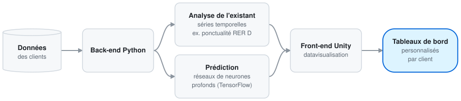
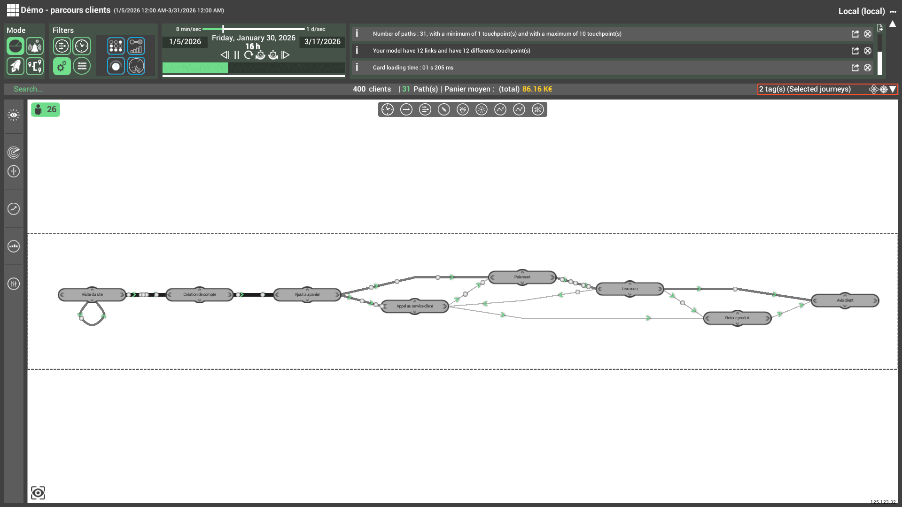
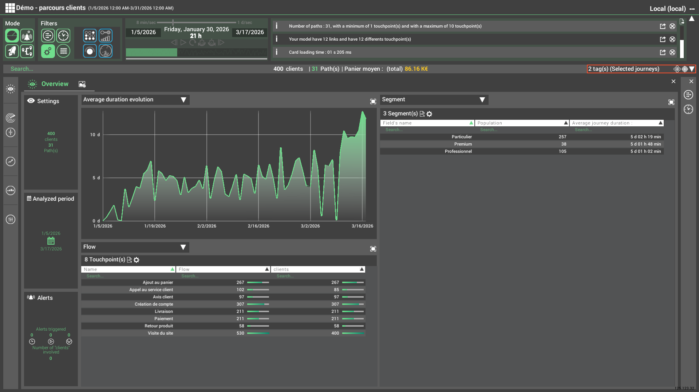
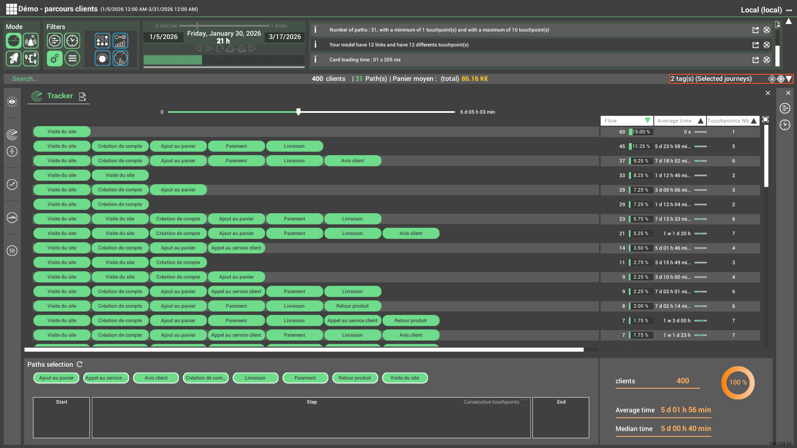
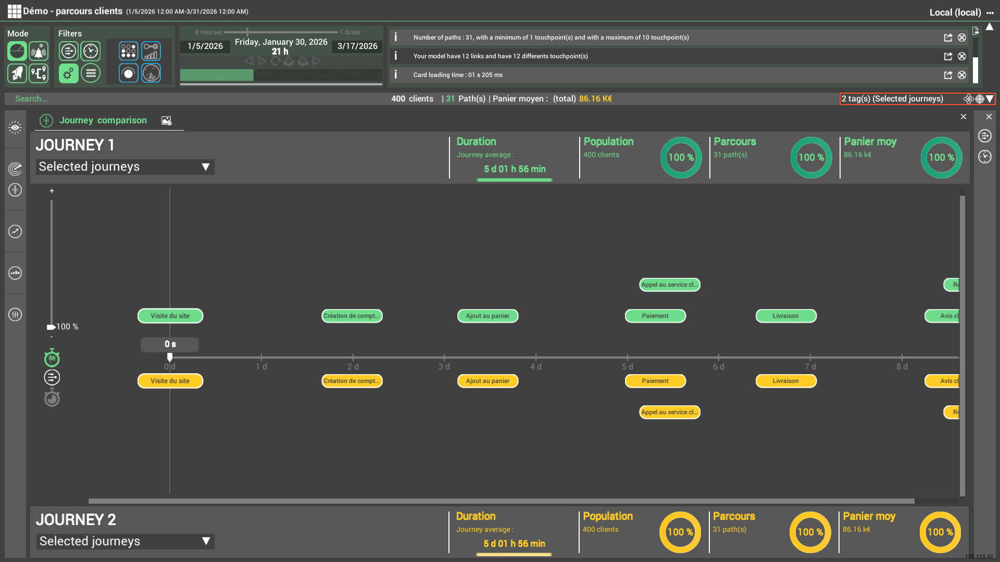

# Your Data Consulting (2016–2019) – Fabien Simon

[← Accueil du portfolio](../fr.md) · [English version](../en/your-data.md)

**CTO, mai 2016 – mai 2019.** Direction technique de *Livejourney*, une solution de datavisualisation et d'analyse de données en temps réel, avec des algorithmes de prédiction par IA. J'encadrais une équipe de 3 développeurs.

### En chiffres
| | |
|---|---|
| 🧭 | Rôle de **CTO** : direction technique de la solution *Livejourney* |
| 👥 | Équipe de **3 développeurs** |
| 🏢 | Clients : **SNCF (RER D)**, **Veepee**, **ID Logistics**, **KPMG** |

### *Livejourney* : architecture

### *Livejourney* en images
| | |
|:---:|:---:|
|  Graphe des parcours animé : chaque point est un client |  Vue d'ensemble : durée moyenne, flux, segments, alertes |
|  Variantes de parcours, de la plus fréquente à la plus rare |  Comparaison de deux populations sur une même échelle de temps |

Captures réalisées en 2026 sur l'application d'origine, simplement portée sur une version récente de Unity, avec un jeu de données de démonstration (parcours clients fictifs).

### Fonctionnalités
- Import d'un journal d'événements (identifiant, interaction, date) et de caractéristiques par client
- **Graphe des parcours** reconstruit automatiquement : une étape par nœud, des liens dont l'épaisseur suit le volume, mise en page automatique (algorithme de Sugiyama)
- **Lecteur temporel** qui rejoue les parcours à la date réelle des événements
- Analyse des **variantes de parcours**, distributions (durée totale, nombre d'interactions, délai d'accès à une étape), flux entrants et sortants
- **Comparaison de populations**, tableaux de bord de **prédiction** et d'**alertes**

### Ce que j'ai fait
- **Direction technique** de la solution et encadrement d'une équipe de 3 développeurs
- **Architecture** : front-end en **Unity**, back-end en **Python**, algorithmes de prédiction par IA

#### IA prédictive
- Prédiction des besoins à venir avec des **réseaux de neurones profonds** (**TensorFlow**) :
  - commandes à venir
  - maintenance du matériel

#### Analyse de données
- Exploitation de **séries temporelles** pour éclairer les décisions stratégiques des clients :
  - **ponctualité des trains** : mesure des retards sur la ligne **RER D** (SNCF)
  - délais de traitement du SAV

#### BI
- Conception de **tableaux de bord personnalisés** selon les besoins de chaque client

### Ce que j'en retiens
- **Premier poste de CTO** : responsabilité de toute la technique d'un produit
- **De la donnée à la décision** : analyse, prédiction, puis restitution visuelle pour les décideurs des clients
- **IA appliquée** : réseaux de neurones profonds au service de cas métier concrets
- **Unity hors du jeu vidéo** : un moteur 3D temps réel utilisé pour la datavisualisation

---
Période précédente : [← Mando Productions (2010–2016)](mando.md) · Période suivante : [Manzalab (2019–2026) →](manzalab.md)
